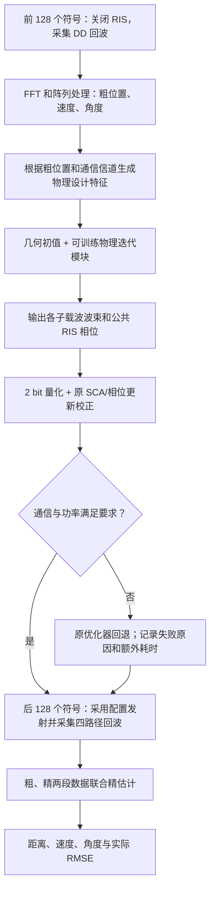

# 第一版方案：模型驱动 AI 辅助 RIS 与基站波束联合设计

日期：2026-10-20。状态：研究/实现方案 v1；G2 的可训练设计和校正模块已实现，9 项本地数学检查通过。尚未进行正式训练，尚无新增性能曲线。实际实现细节见 G2_IMPLEMENTATION.md。

## 给老师的一分钟解释

现有系统先关闭 RIS，利用直达回波粗估计两个目标的位置，再通过交替优化设计基站发射波束和 RIS 相位，重新采集回波，联合估计距离、径向速度和两个角度。我们希望把中间的配置求解过程改成一个可训练的物理迭代模块：保留电磁传播和优化目标的公式，通过离线训练学习每次更新的步长等参数，在有限在线计算预算内获得较好的配置。输出经过 2 bit 量化，并用原优化器进行少量校正，满足通信和功率约束之后才用于发射。最后仍由四路径联合估计器输出目标参数。

第一阶段研究问题是：在相同阵列、带宽、发射能量和无线观测时长下，能否在维持估计精度的同时减少配置耗时，或在相同在线耗时下改善精度？这一点需要实际实验，不预先承诺 AI 一定降低 RMSE。

## 1. 接入链路

基站与目标之间的 DD/RD/DR/RR 传播路线沿用现有模型。AI 放在基站计算端，输出实际发射/反射配置。算法从已有粗观测出发；不能先看到新配置产生的未来回波再决定这次配置。

在代码中，主接入点为 `run_stage3.py` 中调用 `model.design(coarse)` 的位置。新增比较器分别调用传统设计器和 AI 设计器，再分别调用相同的 `simulate_block`、`Observation.refine`。原始基线文件先保留，以独立新目录组织实验，方便审计。

## 2. 输入和输出

设计输入只包含在线可获得的信息：两个目标的粗估计、已知/估计的通信信道、基站/RIS 阵元位置、全部子载波频率、功率预算和通信门限。模型初值沿用几何相位叠加与相位量化的思路。

当前设计目标只需要粗距离和方向来构造几何。速度仍参与后端回波估计；v1 不声称仅把速度输入网络就能提高测速性能。需要利用粗估计不确定性时，必须另外定义可计算的可靠性指标，而不能读取真实误差。

输出为每个子载波的 16 维复发射波束，以及一组长度 64 的公共 RIS 复反射系数。正式部署的 RIS 系数属于 `{1,j,-1,-j}`。12,672 个子载波和两个目标共享同一块 RIS 的设置，不能给每个目标或频点各自分配一套独立相位。

设计接口应使用不含 `truth` 的数据结构；真值只进入信号模拟器和最终评分器。训练场景的真值可用于生成观测，但不作为部署输入。

## 3. 借鉴原论文的什么思想

参考 Peng Jiang 等，Joint Waveform and Beamforming Design in RIS-ISAC Systems: A Model-Driven Learning Approach，IEEE TCOM 2025，DOI: https://doi.org/10.1109/TCOMM.2025.3535869 。原文图 3 将 ADMM、约束处理和拟牛顿迭代组织为网络，通过训练学习更新参数。

本项目拟借鉴“保留物理更新、学习优化参数”的方法。原论文包含符号级波形设计、杂波，并分别优化检测 SINR 和角度 CRB；当前代码是单通信流、双目标、宽带 OFDM、量化 RIS 和距离/速度/双角联合估计。v1 采用适合本项目的可训练投影梯度更新，并不宣称复现原文全部 ADMM/ALM/DFP 结构或继承其性能数值。

## 4. v1 的具体更新原理

当前照射指标为：

\[
J_q=\frac1{N_s}\sum_i\left(|g_{D,i,q}^{H}w_i|^2+
\eta |C_{i,q}(p)|^2|g_{R,i}^{H}w_i|^2\right),\quad p_n=e^{j\varphi_n}.
\]

两部分分别为直达照射与 RIS 辅助照射，沿用代码的归一化级联链路。第一版保持这个物理目标，先回答 AI 求解器本身是否有效。

为训练提供平滑目标，用 soft-min 近似最弱目标指标：

\[
J_{\mathrm{soft}}=-\tau\log\sum_q e^{-J_q/\tau}.
\]

\(\tau>0\) 是显式记录的平滑参数；实际评分仍使用真正的 \(\min_q J_q\)。训练损失还包含归一化通信违约项，例如 \(\mathrm{mean}_i[\max(0,1-\mathrm{SINR}_i/\Gamma)]^2\)。罚项用于学习，不代替最终可行性检查。

每一层先根据当前波束、RIS 与信道计算物理损失的梯度，再更新波束和相位：

\[
W^{l+1}=\Pi_P(W^l-a_l\widetilde\nabla_W\mathcal L),\qquad
\varphi^{l+1}=\varphi^l-b_l\widetilde\nabla_\varphi\mathcal L.
\]

\(\Pi_P\) 控制总发射功率；相位通过 \(e^{j\varphi}\) 保证单位模。带波浪线的梯度采用明确定义的归一化，避免子载波数量和变量尺度改变有效步长；须在代码中记录 epsilon 与尺度，并通过数值梯度检查。\(a_l,b_l\) 是通过训练学习、限制为正且有界的更新参数。初始拟用 6 层，具体数值只由训练/验证集确定。

直观上，物理公式告诉模块“应该往哪里调整”，训练决定“每次调整多少”。它不是直接记住某一对目标的正确答案。固定步长版本是必要对照，才能判断训练本身的收益。

第一阶段训练连续相位更新，随后加入量化感知训练。可以使用前向硬量化、反向直通估计；这种梯度是训练近似，必须标注，并用实际 2 bit 输出评价。若改用平滑离散松弛，同样不得把软相位部署结果当作硬件结果。

## 5. 物理校正与回退

AI 候选配置量化后，以其为初值运行有限次现有 SCA 波束优化和离散相位更新。初始拟定校正预算为 1 次外层交替、1 次 SCA、1 次相位遍历；所有同预算候选方法使用相同校正器。

最终核对：所有子载波的通信 SINR、总功率、公共相位维度、2 bit 合法档位和有限数值。只缩放波束会改变通信质量，因此不能把功率归一化当成通信也达标。

如果有限校正仍失败，使用原 Stage-3 优化器回退；记录原始候选是否可行、失败原因、校正耗时、回退耗时和最终性能。回退次数必须报告，不能把靠原求解器完成的样本全部描述为网络独立成功。

## 6. 离线训练数据与模型选择

为每个训练场景生成真实 DD 粗观测，调用现有粗估计器得到输入。第一版不使用“真值加一个人为高斯误差”代替完整粗检测，因为真实低 SNR 误差可能包含误锁。

拟定 128 个训练几何场景、32 个验证场景，各在 -30/-5/20 dB 生成一个噪声实现。按几何场景划分，不能把同一几何的不同噪声分到训练和测试。新场景测试单独保留 32 个场景。另把原项目固定几何保留为兼容性测试，不加入训练。

目标距离 160–260 m、速度 -20–20 m/s、与 z 轴夹角 15–75°、方位角 -50–50°；通信用户角度也变化。初版将两目标距离差限制为至少 6 m、方向夹角至少 5°，这是明确的场景范围，不能宣称已覆盖不可分辨目标。约束只依据事前几何，不能根据算法结果筛掉失败样本。

训练/验证/测试场景、噪声种子、代码哈希和配置分别保存。模型仅按验证集选择，冻结权重后才开始正式测试。固定几何旧实验的 1,100 个样本不构成独立的泛化训练集。

全部正式训练特征来自完整阵列、子载波与 CPI，物理目标使用所有子载波。若未来为了算力采用子载波采样或低维波束，必须作为另一个明确的近似实验，不能悄悄替换本协议。

## 7. 比较方法与曲线

主比较拟包含以下 6 种方法，使用相同粗观测、相同精观测噪声、相同波形、相同总无线观测预算：

1. 无 RIS 联合精估计：说明 RIS 整套链路的收益。
2. 原 Stage-3：AO=3，SCA=3，相位遍历=2，作为已有算法基线。
3. 短预算传统设计：几何初值 + 1/1/1 校正，说明减少传统迭代的效果。
4. 未训练固定步长展开 + 同样 1/1/1 校正，检验物理结构本身。
5. 训练后的展开 + 同样 1/1/1 校正，检验学习更新参数的价值。
6. 较充分传统优化：拟 AO=8，SCA=5，相位遍历=3，并报告末期改善与停止条件；这是更强参考，不是已证明全局最优。

原几何正式对照：SNR=-30:5:20 dB，每点 MC=100，共 1,100 个配对样本。新场景测试：32 个独立几何、11 个 SNR、每点每场景 3 个噪声实现，共 1,056 个配对样本；其统计含义与固定几何 MC100 明确区分。

输出：角度/距离/速度 RMSE–SNR 三张主图，配置耗时与端到端耗时，通信可行率、校正/回退率、离群率，精度–耗时关系。固定几何按 MC 配对 bootstrap；新几何按场景聚类重采样，再处理场景内重复，不能把共享几何的所有目标和噪声当成独立场景。

距离、速度、两角采用同一次目标匹配，沿用原项目角度定义和度量。保留失检与大误差，不按每种指标挑选最有利匹配，不平滑曲线。基础设施失败使实验保持未完成并允许续跑；算法失败须保留原因，不能从统计分母中无声删除。

只比较固定迭代数不等于比较相同耗时。需记录设备、线程、预热、GPU 同步、传输、量化、校正与回退时间；额外做传统算法计算预算扫描，画实际精度–时间曲线。离线数据生成和训练成本单列。只加速设计模块不意味着整个 FFT/精估计流程同比加速。

## 8. 尺度、运行与适用范围

正式保持 28 GHz、120 kHz 子载波间隔、12,672 子载波、4×4 Tx、8×8 Rx、8×8 RIS、2 bit、128+128 OFDM 符号。物理一致性参考使用 float64/complex128；网络训练也先采用双精度，未来若降精度须单列验证。

本地只进行小规模数学测试和训练/推理/比较链路冒烟。正式数据生成、训练、全尺寸试运行和 RMSE 比较都在服务器。服务器先运行完整尺寸单样本以测资源，再锁定并发；这份方案没有给出未经实测的完成时间。

继续采用现有归一化 LoS 级联链路、已知通信 CSI、已知两个目标、沿基站径向运动的闭合假设，不含 SI。计算时延另行统计，不将其偷偷计为零；在加入执行/切换时延与目标运动模型之前，不宣称实现实时跟踪。

正式实验每个样本保存参数、种子、配置、模型/源码身份、估计值、误差、计时和失败/回退信息，日志记录当前阶段和真实样本数。脚本写完不等于实验完成，任务已启动也不等于得到最终结果。

## 9. 后续研究分支

如果 v1 验证了加速，再研究将照射目标替换为距离/速度/双角联合 Fisher 信息或 CRB。必须处理未知四路径复系数和参数单位归一化，设计端使用粗估计/先验，不直接使用真值。新目标和 AI 求解器分别做消融。

这属于后续增强，不是 v1 已经实现的贡献。单角度 CRB 也不能直接证明当前距离和速度 RMSE 一定下降。

## 10. 汇报时可能被问到的问题

**AI 在哪？** 在粗定位与第二次发射之间，用于配置设计。

**输出什么？** 全频带基站波束，以及一块 RIS 的公共量化相位。

**训练什么？** 物理迭代中的更新参数，第一版是正值有界的分层步长。

**如何保证通信？** 量化后逐频点检查和物理校正，必要时回退并计入成本；损失罚项不是硬保证。

**预期优势？** 计算时间与解质量的折中，须由配对实验验证，不能先承诺 RMSE 数值。

**与原论文有何不同？** 本项目是宽带、多目标、量化公共 RIS 和四参数实际估计；采用借鉴的模型驱动思想，更新结构和任务约束要重新适配。

**现在做到哪？** 已完成方案、流程、拟定协议与 G2 核心实现，9 项数学检查通过；完整数据链路脚本、正式训练、端到端冒烟和正式比较仍在后续阶段。
