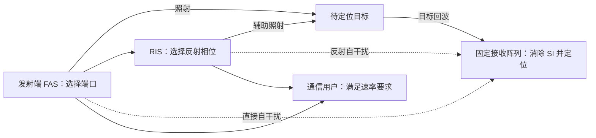

# RIS 辅助定位结合流体天线：选题调研与实施建议

调研日期：2026-10-09。对象：用户上传的 2021 年 IRS 辅助 DFRC 论文，以及当前 MATLAB 工程。本文是选题研究，不代表已经完成新方案仿真或验证了论文创新性；现有仿真主流程未修改。

## 1. 推荐结论

**最建议研究：有限导频、有限阶数字自干扰消除条件下，面向可靠三维定位的 RIS 与发射端流体天线协同设计。**

通俗地说：RIS 帮忙把目标回波送回来；流体天线选择合适的发射位置；两者一起配置，使接收机更容易分清“真正的目标”和“自己的泄漏信号”，同时保证通信。研究重点是定位误差、误锁概率以及消除开销。

可以暂拟题目：

> 面向可靠定位的宽带全双工 RIS–流体天线协同设计：有限阶自干扰消除与定位信息分析
>
> Localization-Oriented Joint Fluid-Antenna Port and RIS Configuration for Wideband Full-Duplex ISAC with Model-Mismatched Self-Interference Cancellation

题目中的“模型失配”必须对应可解释的物理原因，例如宽带 SI 多径超过消除器的建模阶数、校准误差或导频到数据期间的信道漂移。不能为了产生增益而任意添加误差。

这条路线能使用现有 OFDM 波形、三维估计、矩阵 SI 和导频 LS SIC。真正有潜力的贡献是：**解释哪些 SI 分量会损伤定位，建立什么时候协同设计有效、什么时候无效的边界，再用相同硬件与训练资源验证。**

单纯增加 FAS、把目标改为 CRB、套用 AO/SCA，或改用 BnB，都不足以单独支撑强创新。这些方向已有相近研究，见第 3 节。

## 2. 原论文、现有工程与建议场景的区别

原论文为 [Intelligent Reflecting Surface Aided Dual-function Radar and Communication System](https://doi.org/10.1109/JSYST.2021.3057400)。其核心是联合设计 BS 发射波束与 IRS 相位，在满足通信 SNR 和发射功率约束下最大化雷达 SNR。IRS 辅助雷达链路在去程、回程均经过 IRS；它没有建立当前工程这种显式矩阵 SI、导频估计与数字消除模型，也没有以三维定位误差为设计目标。

| 项目 | 原论文 | 当前工程 | 建议主场景 |
|---|---|---|---|
| 感知指标 | 雷达 SNR | 角度、距离、速度误差 | 三维位置误差界、实际误差、误锁/失效概率 |
| 阵列 | 固定多天线 | 16 Tx、64 Rx，固定 URA | Tx 使用离散端口 FAS，Rx 暂保持规则 URA |
| RIS 目标路径 | 去程和回程经过 IRS | Tx→RIS→目标→Rx；返回方向仍采用直接目标的 Rx 导向 | 明确各路径的真实长度、方向与频率响应 |
| 波形 | 波束形成模型 | 28 GHz、1.52064 GHz 带宽、12672 子载波 | 沿用宽带 OFDM，并明确消除器阶数 |
| SI | 未按现有工程显式建模 | 点散射 SI 或矩阵 SI，取决于脚本；新 SIC worker 已使用矩阵 SI | 位置、RIS 相位与频率共同决定的物理 SI |
| 设计信息 | 理想 CSI | RIS 优化使用目标真值；用户默认方向也可能取目标真值 | 已知通信 CSI、粗定位/跟踪先验；真值仅作上界 |

### 2.1 当前代码已经有的能力

- `build_default_params.m`：28 GHz，Tx 4×4、Rx 8×8，两个约 200 m 的目标，OFDM、SI 和 SIC 参数。
- `build_ris_target_model.m`：近场 Tx–RIS 传播和频率相关的相对路径系数。
- `optimize_ris_target_phase.m`：最大化加权目标回波功率的连续/离散相位坐标优化。
- `simulate_radar_channel_3d.m`：目标回波、矩阵/点散射 SI 注入、导频 LS SIC。
- `run_ris_rmse_snr_sic_worker.m`：已经联合运行 RIS、矩阵 SI、128 导频与 SIC，并在方案之间配对 SI、波形、导频和数据噪声。
- `RIS_SIC_MIMO_ZTE_28G`：另有直接 SI 加 RIS 反射 SI 的频率相关信道生成与优化模块，可作为统一模型的参考。

需要区分不同实验：较早的 `run_ris_rmse_snr_worker.m` 未显式配置矩阵 SI；最新 SIC worker 已经配置。因此不能把旧 MC100 汇报的结果直接当成“RIS＋矩阵 SI＋实际 SIC”的证据。

最新 SIC worker 的 RIS 相位仍由目标回波功率优化，注入的 `H_SI_matrix` 并未随 RIS 相位变化。**同一块 RIS 同时影响目标和 SI 的耦合关系，目前还没有统一进这一实验。**

### 2.2 两个必须先理解的几何限制

当前 RIS 与 BS 的距离为 1.5λ≈1.607 cm，目标距离为 200.6 m。以间距除以目标距离估算，视差尺度至多约 0.00459°，具体方向还可能更小。它主要是近 BS 的波场调节器，不能直接当成相距几十米的独立定位锚点。

用阵列对角线作孔径、按 2D²/λ 估算 Fraunhofer 距离：Tx 约 0.096 m，Rx 约 0.525 m，当前小 RIS 约 0.084 m。因此 **BS–RIS 和 Tx–Rx SI 可以是近场，200 m 目标对这些小阵列属于远场**。若写“近场目标定位”，应另选大孔径或更近目标场景。

现有 RIS 系数包含频率相关的相对超额路径相位，不能说“RIS 时延完全没建模”。更准确的问题是：接收方向沿用直接路径、几何与相位参考尚未统一，不能自动推广到独立 RIS 锚点或双 RIS 往返链路。

## 3. 已有论文覆盖了哪些想法

下表基于公开 arXiv 检索和选定正文核查；检索截至 2026-10-09。除原上传论文外，以下以 arXiv 版本标识，未逐篇确认正式期刊出版信息。没有检索到完全相同标题，不等于证明“首次”。

| 文献 | 已有内容 | 对本选题的约束 |
|---|---|---|
| [R1：Movable Antenna-enabled RIS-aided Integrated Sensing and Communication](https://arxiv.org/abs/2407.03228)，2024，核查正文 II–III 节 | MA 位置、RIS 相位、BS 波束联合优化；最大化最小 RIS 波束图增益 | “RIS＋MA＋ISAC＋AO”已经存在 |
| [R2：Fluid Antenna-Assisted Near-Field System](https://arxiv.org/abs/2409.20472)，2024，核查正文 II–III 节 | XL-STARS、FA 位置与波束/协方差联合优化，最小化位置 CRB | “将 SNR 改成 CRB”已有；该文的单 FA 目标/XL-STARS 场景与本工程不同，且把回波限定在指定 RD bin，不研究完整误锁过程 |
| [R3：Joint Transceiver Design for RIS Enhanced DFRC with Movable Antenna](https://arxiv.org/abs/2502.09023)，2025，摘要核查 | 联合接收滤波、发射波束、MA 位置、RIS 相位，最大化雷达 SINR | 加接收波束、改成 SINR 也不新 |
| [R4：Robust Transceiver Design for RIS Enhanced DFRC with Movable Antenna](https://arxiv.org/abs/2506.07610)，2025/2026，核查正文 II 节及算法 | 杂波、通信/感知 CSI 不确定性、鲁棒联合设计 | 简单加 CSI 误差和鲁棒 AO 不足；该文 II 节脚注明确主要用 RIS 辅助通信，雷达忽略 RIS 反射路径 |
| [R5：Joint Antenna Position and Beamforming Optimization with Self-Interference Mitigation in MA-ISAC System](https://arxiv.org/abs/2408.00413)，2024/2025，核查正文 II–III 节 | 全双工单站、位置相关近场 SI、通信速率与感知 MI、收发 MA | “移动天线抑制 SI”已有。粗到细搜索的粗网格阶段仍评估所有组合，不能当作消除了组合复杂度 |
| [R6：Fluid Antenna System-Assisted Self-Interference Cancellation for In-Band Full Duplex Communications](https://arxiv.org/abs/2506.05569)，2025，摘要核查 | Rx FAS 端口选择与相关残余 SI 分析 | “FAS 用于 SI 消除”已有，需区分定位任务与通信任务 |
| [R7：Movable Antennas Meet Intelligent Reflecting Surface: Friends or Foes?](https://arxiv.org/abs/2501.15880)，2025，摘要核查 | 研究 IRS 优化后 MA 的额外收益何时减小 | RIS 与 FAS 的收益有条件，不能假设两者增益自动叠加 |
| [R8：Performance Optimization for Movable Antenna Enhanced MISO-OFDM Systems](https://arxiv.org/abs/2510.01789)，2025，核查正文 III 节 | 全频共享位置、离散化、图方法构造界、BnB 剪枝 | “宽带 OFDM＋MA＋BnB”已有；其通信速率界不能直接用于 PEB |
| [R9：Globally Optimal Movable Antenna-Enhanced multiuser Communication…](https://arxiv.org/abs/2408.15435)，2024/2025，摘要核查 | 离散位置、运动功耗、CSI 误差、BnB 与 SCA | BnB 和移动开销本身不是新贡献；最优性取决于具体模型 |
| [R10：Array Zooming Optimization for Near-Field Localization With Movable Antennas](https://arxiv.org/abs/2604.27352)，2026，核查正文 III–IV 节 | 多次阵列变形、空间混叠、假峰概率、超越单纯 CRB 的定位设计 | “考虑假峰而非只用 CRB”也已有；需要突出宽带 RIS 路径与结构化 SI 的作用 |
| [R11：IRS Aided Target Localization With Unknown Transceiver-IRS CSI](https://arxiv.org/abs/2404.05149)，2024，核查正文 II–V 节 | 未知 BS–IRS 信道、符号模糊、多假设定位、波形/RIS 设计 | “未知 CSI＋RIS 定位＋假设区分”已有；其训练阶段还用成对差分处理静态 SI/散射项 |
| [R12：Joint Localization and Information Transfer for RIS Aided Full-Duplex Systems](https://arxiv.org/abs/2208.06670)，2022，核查正文 II 节 | OFDM、设备上的 RIS、联合定位/信息恢复、Bayesian CRB | RIS＋全双工定位已有；该文假设天线隔离足够，忽略 SI |
| [R13：Grey-Box Bayesian Optimization for ISAC in Fluid-Antenna Assisted Air-Ground Network](https://arxiv.org/abs/2604.02181)，2026，核查正文 II 节、目标函数 | 不完整 CSI、FAS 端口、残余 SI、感知 MI、反馈驱动多目标 BO | 未知 CSI、SI、低训练开销组合已有；定位参数信息与有限阶 SIC 是需要细化的区别 |
| [R14：Joint Beamforming and Position Optimization for MA and Movable-Element RIS-Aided Full-Duplex 6G MISO Systems](https://arxiv.org/abs/2601.08922)，2026，摘要核查 | MA、可移动 RIS 单元、全双工 SI 与通信联合优化 | “RIS＋MA＋全双工”不能单独宣称新颖 |
| [R15：Fluid Antenna Meets RIS: Random Matrix Analysis and Two-Timescale Design for Multi-User Communications](https://arxiv.org/abs/2503.06080)，2025，摘要核查 | FAS–RIS 通信与双时间尺度设计 | 两种更新周期可以用于实现，但不能单独作为创新点 |

本次重点核查了与选题最接近的公开版本，未进行 IEEE Xplore、Scopus 等数据库的完整引文追踪。投稿前应对 R1、R2、R5、R10、R11、R13 做前向/后向引用扩展，并再次检索最新论文。

## 4. 主选题应回答的三个问题

### 问题 A：相同回波强度下，哪些 SI 真正损害定位？

接收机的总 SI 功率，只告诉我们“干扰多大”。定位还关心干扰在空间、频率和时间上的形状：它是否遮挡了用于区分位置的相位变化，是否形成会被 RD 检测器选中的假峰。

拟研究目标：推导考虑未知目标反射系数和校准误差的等效位置 Fisher 信息，分析残余 SI 与位置敏感方向的重叠。需要同时讨论接收机输入 SI 的物理限制，不能因为某个方向对定位不敏感，就忽略 ADC 饱和。

### 问题 B：同样的 SIC 资源，RIS 与 FAS 能否让 SI 更容易被消除？

数字消除器受导频、延迟抽头数、子带数和校准时间限制。物理 SI 却可能随频率变化，也随端口/RIS 配置变化。

拟研究目标：固定消除资源，联合设计端口与相位，降低“消除器无法表示的 SI 分量”对定位的影响。这里的收益应在有限阶模型中出现，并在理想、完整匹配的 LS 基线中减弱或消失，从而建立清楚的机制。

### 问题 C：优化是否真的降低误锁，而不只是改善局部误差界？

低 SNR 或强 SI 时，估计器可能选错峰。正确峰附近的 CRB 很小，也不能保证它选对峰。

拟研究目标：把局部 PEB 和候选位置间的可区分性结合起来；用完整检测/估计链路验证三维误差、失效概率与错误关联。R10、R11 已有假峰和假设距离设计，因此本工作的区别必须落实在结构化宽带 SI 与有限阶消除机制上。

## 5. 建议的系统模型

### 5.1 硬件与训练协议

第一版采用：固定 Rx URA；每个 Tx RF 链连接一个可切换位置的天线；每个天线有少量候选端口。保留与固定阵列相同的 RF 链数、发射功率和总允许孔径。

图中是建议先实现的单次 RIS 反射目标链路；其他回波路径按下文的几何与功率条件取舍。

这里的流体天线可以用可重构/可切换辐射位置实现，不必在仿真里模拟液体流动。连续机械移动模型通常称 MA；离散端口模型适合用 FAS 表述。必须说明实现方式、端口相关性、切换时间与损耗，不能把若干候选端口都当成独立 RF 链或独立信道。

端口配置在一个 CPI 内固定，先在选定配置下训练，再发送数据。RIS 可以先设为 CPI 内固定；若单配置不可区分性太强，再增加 2–4 个已知波束/RIS 探测子块，并计入训练、切换与有效观测时间。跨探测子块要保证目标反射系数/信道的相干性假设成立。

单 CPI 约 2.287 ms，机械天线未必能按该速度移动。若采用机械移动，配置更新应放在多个 CPI 之间；若采用电子端口切换，应给出相应开销。双时间尺度是实现选择，不独立构成创新。

建议先将通信用户和被动雷达目标区分：通信 CSI 来自导频；目标位置来自上一帧跟踪或粗定位。沿用“用户也是目标”的设定时，也必须说明已知通信 CSI 是否已经透露了目标位置。

### 5.2 目标回波与 SI 使用统一坐标

统一保存 Tx 端口、Rx 阵元、RIS 单元、目标和散射体的米制坐标。所有子载波使用同一套物理坐标，频率只改变传播相位和硬件响应。

以第 q 个目标为例，频域回波系数可写为：

\[
[H_q(f)]_{ji}=\alpha_q\sum_{\ell\in\mathcal P_q}
a_{ji\ell}(f,\mathcal S,\phi)
\exp\{-j2\pi f L_{ji\ell}(\mathcal S,p_q)/c\}.
\]

其中 \(\mathcal S\) 是端口配置，\(L\) 是整条路径长度。至少明确以下路径是否存在、是否保留：

1. Tx→目标→Rx；
2. Tx→RIS→目标→Rx；
3. Tx→目标→RIS→Rx；
4. Tx→RIS→目标→RIS→Rx。

第一版可只保留当前单次 RIS 反射路径，但须给出其他路径被忽略的遮挡、天线方向或功率依据。若复现原上传论文的双 RIS 往返场景，需要重新建立返回路径；单次反射增强模型不能直接替代。

各路径的目标散射系数是否共享、相对幅相是否已知，会影响可辨识性。若不能校准，应纳入未知干扰参数，不能先假设完全已知后把增加的信息全部计为定位收益。一般路径的 Doppler 应由路径长度的时间导数计算，外置 RIS 场景不宜统一套用直接单站的 \(2v/\lambda\)。

同一 RIS 下的 SI 模型可写为：

\[
H_{\rm SI}[m;\mathcal S,\phi]
=H_{\rm direct}[m;\mathcal S]
+G_{\rm Rx,RIS}[m]\operatorname{diag}(\phi)G_{\rm RIS,Tx}[m;\mathcal S]
+H_{\rm scatter}[m;\mathcal S].
\]

同一个 \(\phi\) 必须同时作用于目标、通信和 SI，不能给同一块 RIS 分配互不关联的“目标最优相位”和“SI 最优相位”。实际 RIS 可设为 1–3 bit 相位；宽带响应采用一组固定控制状态对应的频率响应，不能每个子载波任意选择一套独立物理相位。

### 5.3 残余 SI 的来源

\[
r[m,l]=(H_{\rm SI}[m]-\widehat H_{\rm SI}^{(L_{\rm tap})}[m])x[m,l].
\]

\(L_{\rm tap}\) 表示有限抽头/子带模型的复杂度。建议分开研究：纯热噪声 LS、有限阶宽带模型失配、导频后漂移；逐项加入以确认机制。

不能对每个候选端口重新抽一份独立 SI。应固定散射体/路径增益，在同一个环境中按端口坐标重算距离和相位。否则“端口优化”会变成挑选独立随机样本。

## 6. 定位指标与优化问题

### 6.1 从三维位置到等效信息

把所有选定频率、时刻和接收阵元的观测写成：

\[
y=\mu(\xi;d)+r+n,\qquad d=(\mathcal S,\phi,W),
\]

其中 \(\xi=[p^T,\eta^T]^T\)，\(p\) 为三维位置；\(\eta\) 可包括反射系数实虚部、速度及确定性的未知校准参数。多目标时应建立联合参数向量，保留目标间耦合。

一个可分析的基准是边缘化的 proper complex Gaussian 残差：

\[
R(d)=\sigma_n^2I+B(d)C_eB(d)^H.
\]

它适用于明确建模的随机校准/估计误差。若残差有确定性均值或未建模目标泄漏，应显式纳入均值与未知参数，或使用相应失配分析；不能全部当成独立白噪声。也不能对同一误差同时做随机边缘化和确定性 nuisance 消除而重复处理。

当 \(R\) 与未知位置等参数无关、\(D=\partial\mu/\partial\xi\) 时：

\[
J=2\operatorname{Re}\{D^HR^{-1}D\},\qquad
J_{p,\rm eff}=J_{pp}-J_{p\eta}J_{\eta\eta}^{-1}J_{\eta p},
\]

\[
\operatorname{PEB}=\sqrt{\operatorname{tr}(J_{p,\rm eff}^{-1})}.
\]

PEB 是位置误差的理论下界尺度，单位为米，不等于算法实际 RMSE。先检查可辨识秩；位置 EFIM 奇异时不能声称存在有限 PEB，也不能靠给它加一个任意正则项掩盖。

若协方差也依赖未知参数，FIM 还包含
\(\operatorname{tr}(R^{-1}R_{,i}R^{-1}R_{,j})\) 项；上式的均值导数部分不能独立作为完整 FIM。

为直观看出 nuisance 的影响，可令
\(G=[\operatorname{Re}(R^{-1/2}D)^T,\operatorname{Im}(R^{-1/2}D)^T]^T\)，即将白化导数的实部、虚部纵向堆叠。对可辨识的 nuisance 子空间：

\[
J_{p,\rm eff}=2G_p^T\left[I-G_\eta(G_\eta^TG_\eta)^{-1}G_\eta^T\right]G_p.
\]

它表明回波增强若只改变未知反射系数能吸收的幅相，未必增加独立位置信息。

### 6.2 建议第一版目标函数

使用粗定位/跟踪得到的区域先验 \(\pi(p)\)，或先验区域上的有限场景集：

\[
\min_{\mathcal S,\phi,W}
\mathbb E_{p\sim\pi}\left[\operatorname{tr}(J_{p,\rm eff}^{-1})\right].
\]

配套约束：通信 SINR/速率下限、总发射功率、端口可用区域与最小间距、RIS 离散控制状态、每条 Rx 链输入 SI 上限、固定导频和消除器阶数。

低 SNR 版本增加候选位置区分约束或经过验证的误锁代理指标。例如，对指定反射幅度/先验下的真实候选与错误候选，计算白化后的均值距离，并对错误候选的未知幅相进行最小化。这相当于比较“最容易混淆的两个解释”，而不只比较局部导数。

候选点来自 ROI/粗定位结果，不得由真实目标坐标定制搜索区域。若代理指标没有严格概率推导，应称为代理，并用实际错误峰选择概率验证，不能直接把它标成误锁概率。

## 7. 应争取的理论结果与已做的检查

### 7.1 完整匹配 LS 下的“无额外 SI 收益”边界

当前 `estimate_si_channel_ls.m` 的热噪声基线满足：

\[
Y_p=GX_p+Z_p,\quad
\widehat G=Y_pX_p^\dagger=G+Z_pX_p^\dagger.
\]

当导频满行秩、模型完全匹配时：

\[
(G-\widehat G)X=-Z_pX_p^\dagger X.
\]

因此，在相同导频、相同导频噪声、相同发送数据下，残差与原始 \(G\) 无关。端口/RIS 降低原始 SI，未必降低消除后的绝对残差。波束改变、非正交导频、ADC 失真、漂移或模型失配会改变结论的适用条件，应分别分析。

这也提醒我们：消除 dB 数变大，不必然代表消除后定位变好；原始 SI 变小后，消除 dB 数还可能变小，但残差相同。

独立代数检查：原始 SI 功率相差约 116 倍的两个矩阵，使用相同导频/噪声/数据后，残差的最大数值差为 1.93×10⁻¹⁵。它验证上述恒等式，**不是新 FAS 方案的性能结果**。

### 7.2 单波束、未知反射系数下的“仅增益”边界

若一个窄带/单配置模型可分解为
\(\mu=\alpha\,c(p,d)\,a_{\rm Rx}(p)s\)，且 Tx/RIS 只改变共同的非零标量 \(c\)，那么未知复系数 \(\alpha\) 可以吸收这个变化。在相同接收 SNR、相同 Rx 几何下，单靠这个标量不能增加独立的位置信息。

该结论有明确条件，不适用于一般频率相关或多配置模型。它用于判断收益到底来自回波能量、SI 改变，还是增加了可区分的观测结构。多波束/多 RIS 配置、有效的宽带路径响应或真正分离的 RIS 几何可能打破这一边界，但仍需校准和秩分析。

### 7.3 总 SI 功率与位置误差可以排序相反

做了一个四维 Gaussian 示意模型：第一维是未知幅度，后三维对应位置敏感方向，热噪声协方差为单位阵。

| 情况 | SI 放在哪个方向 | 总 SI 功率 | 归一化 PEB |
|---|---|---:|---:|
| A | 某个位置敏感方向 | 9 | 2.449 |
| B | nuisance 幅度方向 | 100 | 1.225 |

这说明低总功率不必对应更多位置信息。**数值单位是示意模型的归一化单位，不是米，也不是当前系统的仿真增益。**物理方案仍须满足每链 ADC 输入约束。

这一排序现象本身不宜宣称是全新定理；应在本场景中推导其具体条件，形成可解释的配置准则，再通过物理信道验证。

## 8. 算法与 BnB 怎么用

### 8.1 计算量先从模型结构中减下来

16 个 Tx、每个 4 个端口，就有 4¹⁶≈42.95 亿种配置，还未加入 RIS 相位。64 个 2-bit RIS 单元的组合数为 4⁶⁴。全联合穷举不现实。

当前完整 Rx 数据立方体仅数组本身就约 1.547 GiB（复单精度）或 3.094 GiB（复双精度）。每个候选配置都生成它再跑估计器，会非常昂贵。

建议的实际优化流程：

1. 缓存固定环境下各 Tx 端口到 RIS、Rx、用户和候选目标区域的信道/导数；改一个端口时更新相关列。
2. 优化器评估小维度联合 FIM、信道与低秩残差模型，完整数据立方体只用于最终配置的 MC 验证。
3. 使用结构化矩阵乘法/流式累计 Gram 矩阵；对 \(\sigma^2I+BC_eB^H\) 使用低秩求逆形式，避免构造巨型观测协方差。
4. 先用少量跨全带宽的代表频率优化，再以完整频率模型复核；频率权重必须反映实际资源和能量。
5. 端口用可行坐标交换/多起点搜索，RIS 用离散相位更新，波束用条件优化；接受更新时检查真正目标与约束。

频率抽样仅是优化近似。若直接把 12672 子载波改成几十个等间隔且仍声称覆盖 1.52 GHz，会改变距离无模糊区间和假峰结构，不能原样送进现有 FFT 后当作公平定位实验。

AO 的有界单调目标值收敛，也不自动意味着全局最优或各变量收敛。离散相位应报告终止准则、初始化敏感性和约束违规。

### 8.2 BnB 的位置：小规模证书与条件子问题

BnB 的含义是：把端口组合分组，对每组计算最乐观的目标界；如果它都不可能超过当前最好可行配置，就停止搜索该组。

建议从 4 个 Tx、每个 4–8 个端口开始。固定 RIS 与波束，研究位置子问题的可靠界；与穷举验证，再评估剪枝效果。完整 16 Tx 场景使用低成本方法，并用小规模证书说明解的质量。

**在 AO 内把端口子问题用 BnB 精确解出，不等于整个端口、RIS、波束联合问题全局最优。**离散端口全局最优也不等于连续位置全局最优。代表频率模型的证书不能直接搬到完整宽带模型。

### 8.3 一个能证明有效、但可能较松的下界

下面给出单目标条件子问题的起点，便于把 BnB 从“算法名称”变成可检查的研究对象。假定 RIS/波束固定、SI 协方差不依赖未知位置、\(R\succeq\sigma_n^2I\)。由于发射信号线性叠加，位置导数可写成已固定端口贡献与未决贡献之和：

\[
D_p=A+\sum_{i\in\mathcal U}C_i(s_i),\qquad
\rho=\sum_{i\in\mathcal U}\max_{s_i\in\mathcal C_i}\|C_i(s_i)\|_2.
\]

对任意 \(\epsilon>0\)，未决贡献的谱范数至多为 \(\rho\)，因此：

\[
J_{p,\rm eff}\preceq J_{pp}\preceq
\overline J=\frac{2}{\sigma_n^2}\operatorname{Re}
\{(1+\epsilon)A^HA+(1+1/\epsilon)\rho^2I\}.
\]

当相关矩阵可逆时，得到最小化 PEB² 的合法下界：

\[
\operatorname{tr}(J_{p,\rm eff}^{-1})\geq
\operatorname{tr}(\overline J^{-1}).
\]

它利用去除 SI、去除 nuisance 的乐观模型作界，可能非常松。结构上有希望的进一步研究是利用 SI 子空间、端口之间的几何约束以及导数相关性收紧此界。若协方差对未知位置的导数也进入 FIM，这个界需要重新推导。

独立合成矩阵检查覆盖了某个节点下的 16 种完成配置：PEB² 下界约 0.00619，实际完成配置的最小值约 0.03953；检查未发现 PSD 界违反。该界相差约 6.4 倍，说明 **有效性与剪枝效率是两件事**，目前不能宣称它能显著加速真实场景。

剪枝必须依赖可证明的下界及不可行性判据。一次局部 SCA 的值、某几个候选点的最小值、学习模型预测，都不是自动有效的下界。误锁代理约束若没有相应可靠界，可在完整候选上检查，不能用启发式估计随意剪掉分支。

若提前停止 BnB，应报告当前可行解上界、尚未展开节点的全局下界及差距，并明确它对应的条件子问题。

## 9. 代码改动路线与兼容性

以下为拟实施清单，当前未修改这些源文件。

| 当前文件 | 建议工作 | 原因 |
|---|---|---|
| `build_default_params.m` | 加统一几何、候选端口、切换开销、RIS bit 数、SI 消除阶数、位置先验字段 | 让实验条件可追踪 |
| `generate_HSI.m` | 按固定散射环境、真实端口坐标和频率计算；使用公共幅度标定 | 当前 LoS/NLoS 各自重新归一化 Frobenius 范数，会抹掉部分物理幅度变化；当前 NLoS 模型不能直接代表任意位置连续场 |
| `RIS_SIC_MIMO_ZTE_28G/generate_ris_mimo_channels.m` | 固定米制 RIS 单元坐标，共享 Tx/Rx 坐标；按频率计算响应 | 当前子载波循环使用 λ_m 缩放 RIS 单元坐标，不能直接解释为一块固定宽带硬件 |
| `build_ris_target_model.m` | 改为统一几何下的路径/频率响应，支持实际端口配置与假设目标位置 | 当前固定 URA、K_stream=1，并用真值建模；这是 oracle 相位优化的来源 |
| `generate_mimo_ofdm_waveform.m` / `design_precoder.m` | 通信信道和目标照射系数使用真实坐标；显式评价通信约束 | 当前用户默认方向可能是第一个目标真值；ZF 波束不是定位最优波束 |
| `simulate_radar_channel_3d.m` | 统一目标/SI 路径、共享 RIS 相位、有限阶宽带 SIC 与漂移 | 当前用回波比例修正连接 RIS；矩阵 SI 主要是共用的频率平坦矩阵 |
| `estimate_si_channel_ls.m` | 保留理想 LS 作为机制对照，另加可解释的有限阶/子带估计器 | 防止把理想模型当成位置相关残差来源 |
| `optimize_ris_target_phase.m` | 保留现有回波功率法作基线；新增位置 EFIM 与可靠性目标 | 回波功率最优不保证定位最优 |
| `joint_estimator_fast.m` | 固定 Rx 时保留角度模块，更新已知发射参考和路径字典；必要时局部 ML 精化 | 相邻阵元相位差要求规则 Rx；Tx 参考当前取所有 Tx 信号和，改变波束/坐标后也需核查 |
| `evaluate_estimation.m` | 加 XYZ、严格一一关联、失效/漏检/虚警记录与逐目标原始误差 | 当前贪心匹配可能复用真值；缺少 pooled 三维 RMSE |
| `run_ris_rmse_snr_sic_worker.m` / 聚合脚本 | 增加先验、物理环境和协议种子的配对，固定预算并记录配置/原始指标 | 可复用已有断点续跑，但统计方式需要扩展 |

可新增独立模块：`build_joint_geometry.m`、`generate_position_dependent_channels.m`、`compute_localization_efim.m`、`optimize_fas_ports.m`、`run_ris_fas_localization_study.m`。先与主流程隔离，验证无 FAS、无 RIS、完美 SIC 等极限情况一致后再接入。

**不建议第一版随意移动 Rx 阵元。**当前 `joint_estimator_fast.m` 的相邻子阵相位差依赖等间距平移不变性。改成任意 Rx 坐标，要重写坐标感知的匹配滤波、MUSIC 或 ML 模块。Tx-only FAS 的改动较小，但仍必须更新发射参考；不能承诺保留 Rx 就完全无需改估计器。

## 10. 实验怎样证明贡献

### 10.1 最少需要的比较方案

| 对照 | 要回答的问题 |
|---|---|
| 固定阵列、无 RIS | 总体参考 |
| 固定阵列＋优化 RIS | FAS 是否有额外价值 |
| FAS＋无 RIS | RIS 是否有额外价值 |
| FAS＋RIS 分别按回波功率/SI 功率优化 | 单独优化是否损失了任务相关信息 |
| FAS＋RIS，PEB 优化，残差当白噪声 | 协方差结构是否重要 |
| FAS＋RIS，结构化残差 PEB 优化 | 信息设计本身的贡献 |
| 上一方案＋候选区分/误锁约束 | 低 SNR 可靠性是否改善 |
| 完整匹配 LS、有限阶 SIC、genie SIC | 收益出现在哪种消除机制下 |
| 小规模穷举/BnB、大规模坐标法 | 解质量、运行时间与规模能力 |

R1/R5 等论文的算法若适用于相同模型，可以重实现为比较；若场景不同，应标为改编基线，不能直接比较各论文表中的数字。

### 10.2 公平性条件

相同 RF 链、总发射能量、带宽、允许孔径、RIS 面积、通信 QoS、导频数和消除器阶数。固定阵列应包括合理的孔径优化/位置优化基线，不能只让 FAS 使用更大区域。

同一环境下共享散射体、路径增益和随机种子；噪声功率按同一物理参考固定。当前 RIS worker 已经固定无 RIS 的噪声参考，这一点可保留。另做相同目标回波 SNR 下的诊断，用来分离能量收益与结构收益；该诊断与相同发射功率实验分别报告。

优化信息来自粗定位先验、通信导频或历史帧；真实目标坐标只能用于 oracle 上界。先验应有偏差、宽度和失配扫描。

SI 指标至少分别报告：每条 Rx 链进入 ADC 前的功率、总 SI、数字消除后残差、定位处理后的干扰，以及通信性能。固定有限 ADC 输入约束；必要时增加饱和/量化验证，不能从线性接收模型直接宣称硬件无饱和。

### 10.3 定位统计要改成可发表的口径

按当前角度约定，把估计值转为：

\[
\widehat p=\widehat R[\sin\widehat\theta\cos\widehat\varphi,
\sin\widehat\theta\sin\widehat\varphi,\cos\widehat\theta]^T.
\]

对正确匹配的样本保存位置平方误差，先跨 MC/目标平均平方误差，再开方。均值或中位数的“每次试验 RMSE”，都不等于这个 pooled RMSE。

另外报告位置误差 CDF、95% 分位数、给定误差门限下成功概率、错误关联/误锁比例，以及漏检/虚警。漏检不能变成 NaN 后静默丢弃；正确关联条件下的 RMSE 应明确标为条件指标，并配套失效概率或采用预先定义的集合误差指标。

当前估计器选取固定目标数的候选峰，“检测到 2 个”不等于检测正确。要报告检测 ROC/虚警率，需要加入可校准的检测决策；否则明确是已知目标数的估计基准。

距离分辨率约 0.099 m 不代表三维定位达到 0.1 m。200 m 处 1° 的方向误差对应约 3.5 m 的横向误差，因此要检查角度性能而不只看距离。

### 10.4 必须包含的扫描

SI 强度和多径延迟扩展；SIC 抽头/子带数；导频数；CSI/校准漂移；RIS bit 数；端口数量与可动区域；RIS–BS 间距；目标角度/距离和先验误差；带宽；算法预算。

低 SNR/强 SI 转折区域增加 MC，报告概率指标的置信区间。已有 MC100 汇报中无 RIS 方案的大角度误差，应先排除错误锁峰、门限影响、匹配和 oracle 设置，再用作创新动机。

## 11. 实施顺序与停止条件

### 阶段 1：先确认机制

先做少 Tx/Rx 的物理模型、单目标信息分析，以及理想 LS 和有限阶 SIC 两种情况。保持正确的物理频率网格；减少空间维和数据符号数来控制内存，不随意破坏距离无模糊范围。核查统一坐标、无 RIS/FAS 极限、导数和 EFIM 的秩。

最低要求：理想 LS 的无额外 SI 收益边界可复现；有限阶模型产生可解释的位置/相位相关残差；优化所需信息能由合理先验获得。

若有限阶/漂移模型下，FAS 在相同孔径和预算下仍无稳定增益，应收缩主张或换场景。不要继续扩大 MC 来掩盖机制不足。

### 阶段 2：证明有定位收益

加入双目标、先验误差和结构化残差；比较功率优化、PEB 优化及候选区分优化。检查 PEB 与实际误差在高 SNR 的一致性，以及低 SNR 误锁转折。

最低要求：至少一个有物理意义的区域内，结构化设计相对功率设计有稳定优势；优势不完全依赖真值或更大孔径；通信和 ADC 约束成立。

### 阶段 3：算法与完整规模

小规模用穷举/BnB 确认解质量和合法界；大规模使用缓存/低秩/坐标更新方法，测目标评价次数、峰值内存与实际运行时间。最后接回 16 Tx、64 Rx、完整 OFDM 与 MC 框架。

若 BnB 的界很松、节点数接近穷举，就把它保留为基准，不宣称低复杂度主算法。若 RIS 优化已让 FAS 增益消失，应展示这个边界，而不是筛选唯一有利的信道。

## 12. 两条备选路线及投稿定位

| 路线 | 主要研究问题 | 代价/风险 | 建议 |
|---|---|---|---|
| 主线：近 BS RIS＋Tx FAS＋有限阶 SIC | 同资源下减少结构化残差造成的定位信息损失与误锁 | 必须改统一 SI 模型；理想 LS 下可能没有额外 SI 收益 | 最贴近当前代码，优先做机制实验 |
| 外置墙面 RIS＋FAS 的 NLoS 三维定位 | RIS 提供真实分离的几何路径；端口/探测配置改善可辨识性 | 需新路径字典、时延/方向估计和关联；R11 等已有大量定位研究 | 当前主线收益不足时转向，不能沿用近 BS RIS 的锚点解释 |
| 动态多配置 FAS/RIS 可靠定位 | 多次观测抑制位置模糊，同时估计 SI/目标 | 相干校准、运动与切换开销更重；R10 已有 MA 多次阵列变形 | 后续拓展，暂不堆进第一篇 |

若形成 EFIM/可辨识边界、失效机制与有证明的算法，且真实定位链路吻合，具备考虑 IEEE TSP 一类信号处理期刊的基础；若通信 QoS、宽带协议、SI 硬件和训练预算是主线，可考虑 IEEE TWC 一类无线通信期刊。偏应用且理论较少的版本可按实际成熟度考虑 IEEE TVT 等期刊。选刊应取决于完成后的贡献，不由技术数量决定，也不能保证录用。

**当前最该做的下一项实验：固定通信与训练预算，用统一的宽带 SI 模型验证“功率最优配置”和“定位信息最优配置”是否出现可重复的差别，并以理想 LS 作负对照。**这一步比立即扩展到全收发 FAS 或大规模 BnB 更能判断选题值不值得做。

## 13. 本次交付与证据边界

- 本报告：论文/代码差异、15 篇相关文献、主选题、建模、可证明的条件 BnB 界、代码改动图谱与验证路线。
- 同目录 `sanity_checks.py`、`sanity_results.json`：几何尺度、LS 恒等式、SI 方向示意和合成 BnB 界检查，可用 NumPy 复现。
- 同目录 `literature_metadata.json`：本次选取文献的公开 API 元数据与核查层级。
- 本次没有重跑工程级 MATLAB MC，没有测得新 FAS/RIS 算法的定位性能；报告中的预期贡献与建议仍需后续理论、仿真及更完整文献追踪确认。

原上传 PDF 的已核实持久副本：[论文 PDF](<C:/Users/Fubuki/xwechat_files/wxid_w7136pml97ie22_efce/msg/file/2026-10/Intelligent Reflecting Surface Aided Dual-function Radar and Communication System.pdf>)。
