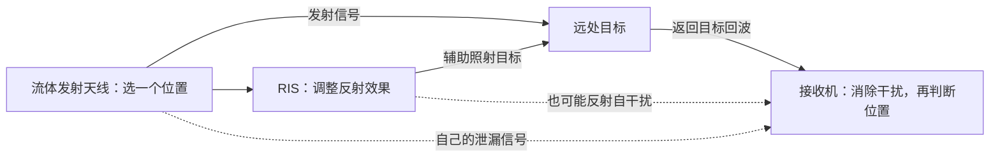

# 让 RIS 和流体天线配合，把目标位置找得更准

一份不需要数学基础的研究说明

这份报告回答一个问题：**怎样把你现在的 RIS 辅助定位代码，加上流体天线，发展成一个值得研究的论文选题？**

我的建议是研究：设备一边发射、一边接收时，自己的信号会干扰自己。我们能不能通过选择天线位置、调整 RIS，让它更容易认出真正的目标，减少定位错误？

目前这是有文献和代码分析支持的研究方向，还没有完成新方案的性能实验。后面提到的预期好处，都需要通过实验确认。

## 一、先把整个系统想成“边说话，边听回声找人”

想象你站在一个大房间里，旁边有扬声器和麦克风。你用扬声器发出一段声音，再用麦克风接收从远处物体反弹回来的声音，希望判断那个物体在哪里。

实际系统用的是电磁波。这个比喻只是为了帮助理解。

| 你的系统里有什么 | 可以怎样理解 | 它负责什么 |
|---|---|---|
| 基站的发射天线 | 扬声器 | 发出信号 |
| 基站的接收天线 | 麦克风 | 收集返回的信号 |
| 待定位目标 | 远处会反射声音的物体 | 把一部分信号反射回来 |
| RIS | 可以调整反射效果的板子 | 改变一部分信号的传播与叠加方式 |
| 流体天线 | 可以换发声位置的扬声器 | 在有限区域内选择更合适的发射位置 |
| 定位算法 | 听回声、判断位置的大脑 | 根据接收到的信号估计目标位置 |

系统通过返回信号的时间、不同接收天线之间的差别等线索判断距离和方向。如果目标在移动，信号中还会留下与速度有关的变化。

问题在于：麦克风也会直接听到旁边扬声器的声音。这个声音可能远强于远处返回的回声。

**自己发出的信号，直接或经过周围反射，跑进自己的接收端，妨碍接收目标回波，这就叫“自干扰”。**

它和普通的背景噪声不完全一样。它来自设备自己的发送信号，有一定规律，因此可以尝试预测和消除。

## 二、RIS 和流体天线分别能帮什么忙

### RIS：调整信号反射回来时的配合方式

RIS 上有很多小单元。你可以把每个单元想成一个小反射器，通过电子控制调整它反射电磁波时的“节奏”。

不同路径的电磁波叠加时，有时会互相增强，有时会互相抵消。RIS 就是在调整这种配合。

比如，我们希望更多信号到达目标，让目标返回的信号更容易被接收。同时，也可能希望某些会进入接收机的泄漏信号得到削弱。

这里的“反射板”是比喻。实际 RIS 通常调整小单元的电磁响应，不需要把整块板子像镜子一样转来转去。被动 RIS 也不会凭空产生额外发射功率。

### 流体天线：给天线多几个可选择的位置

普通天线安装好之后，位置基本固定。流体天线允许有效的发射或接收位置在一个有限区域内变化。

第一版仿真可以理解为：**一个天线有几个候选位置，每次选择其中一个位置工作。**这些候选位置叫“端口”。

实现这种变化不一定要使用会流动的液体，也可以通过电子切换等方式实现。论文里需要说明具体采用哪一种实现方式。

你可能会觉得：挪动一点点，真的有用吗？

你的系统工作在 28 GHz，电磁波的波长大约只有 1 厘米。天线移动几毫米到几厘米，就可能明显改变不同路径信号的叠加情况。因此，某个位置可能让目标信号更强，也可能让自干扰更弱。

但它不保证每次移动都有好处。有些位置会更差，而且相邻位置的信道通常存在关联，不能把每个位置都当成一次全新的随机抽奖。

### 两者配合：选位置，也调反射

在发声找人的比喻里，流体天线负责选择从哪里发声，RIS 负责调整一部分声音经过反射后的效果。

两者会互相影响：天线换了位置，原来适合的 RIS 设置可能就不再合适；RIS 换了设置，最佳天线位置也可能改变。

所以我们需要一起选择它们，这就是“联合优化”的直观意思。

图中画的是建议先实现的一种路径。真实研究还需要根据设备摆放和遮挡情况，判断哪些反射路径需要保留。

## 三、原论文、你的代码、我们想做的工作，有什么关系

| 阶段 | 用一句话说明 |
|---|---|
| 你提供的原论文 | 调整发射方式和 RIS，让雷达回波更强，同时满足通信要求 |
| 你现在的代码 | 生成信号、加入目标回波与干扰，再估计目标的角度、距离和速度 |
| 我建议的新研究 | 加入可选天线位置，研究怎样让系统在自干扰下更可靠地判断目标位置 |

原论文给了我们“发射端和 RIS 一起设计”的思路。你的代码提供了一个更具体的检验环境：我们可以真正跑定位过程，看最后找得准不准。

需要说明的是，原论文的一个重要雷达路径在去程和回程都会经过 RIS；你当前接入主流程的 RIS 目标模型主要是发射端经过 RIS 照射目标，再由目标返回接收端。两者的路径不同，后续不能直接把其中一个模型的结论搬到另一个模型。

你已经有波形、目标、干扰、消除和估计这些模块，所以这条路线可以在现有工程上逐步开展。

## 四、为什么“回波更强”，还不足以说明定位更好

先想两种定位错误。

**第一种：认对了目标，但是测得不够准。**

例如，目标在某个位置，系统的结果在它附近抖动。这时，让回波更清楚，往往有帮助。

**第二种：系统认错了。**

接收到的信号里面可能有真正的目标回波，也有泄漏信号、其他反射和处理后出现的假峰。系统可能把其中一个错误峰当成了目标。

“误锁”就是这个意思：算法锁定了错误的线索，继续很认真地计算，最后给出一个错误的位置。

下面只是说明这两种错误的虚构例子，不是现有代码的实验结果：

| 真实目标距离 | 系统估计结果 | 发生了什么 |
|---|---|---|
| 200 米 | 200.2 米 | 大体认对目标，但有测量误差 |
| 200 米 | 另一个错误距离或方向 | 可能选错了峰，追着错误线索计算 |

研究定位时，这两类问题都要看。只报告“正确认出目标之后，误差有多小”，会遗漏那些完全认错的情况。

我们希望证明：新设计既能改善找对目标之后的精度，也能减少找错目标的次数。是否两方面都有提升，需要实验判断。

## 五、最值得研究的三个问题

### 1. 哪些干扰，最容易让系统找错目标？

在房间里听人说话时，很大的空调声和较小的另一段人声，造成的影响不一定相同。后者可能更容易让你听错内容。

定位也有类似情况：干扰有多强是一方面，它在时间、频率和不同接收天线上的样子，也是重要线索。

某些干扰虽然总能量不大，却刚好妨碍算法区分两个位置；某些干扰虽然更强，但形态明显，算法可能更容易把它和目标区分开。

**我们要研究：什么样的干扰最伤定位，并据此选择天线位置和 RIS 设置。**

这不意味着可以放任接收机承受非常大的干扰。干扰太强，接收硬件可能先失真，后面的算法就没有可靠数据可用。实验仍然需要限制接收机入口处的信号强度。

### 2. 在消除能力相同的情况下，能不能让干扰更容易处理？

数字自干扰消除可以理解为制作一份“自己声音的回声模板”。

设备先发送一段已知信号，听听自己的声音经过周围环境后变成了什么样，再根据这个规律预测泄漏信号，把预测出的部分从接收信号中减去。

这段用于学习的已知信号，叫“导频”。你可以把它理解为校准用的测试片段。

现实中，学习时间和处理能力有限。消除器可能只能记住几条主要传播路径，但实际环境有更多反射；设备校准之后，环境也可能发生变化。于是减完之后还会剩下一部分干扰。

我们的想法是：**在不额外增加消除器能力的情况下，选择更合适的天线位置和 RIS 设置，让剩下的干扰更少影响定位。**

如果只有把消除器做得更复杂才能获得提升，就不能把全部好处归功于流体天线和 RIS。

### 3. 怎样较快地选出好的配置？

假如每根天线都可以选几个位置，RIS 又有很多可以调整的单元，组合会很快变多。

我们需要找到一个效果好、计算量也合理的方法。可以先调整一根天线的位置，再调整 RIS，再调整发射方式，循环改进；也可以保存之前算过的结果，避免每次都重算全部信号。

但“循环调整”本身已经很常见。若想作为论文贡献，需要说明为什么这样调整有效、比哪些方法省计算，以及为了省计算损失了多少性能。

## 六、现有代码里，有几处必须先处理好

### 接收天线先保持不动

你现在的角度估计方法利用了接收天线排列整齐、间距固定的特点。

可以把它理解成一把尺子：算法知道每条刻度在哪里，才能根据测量结果换算角度。如果把刻度挪走，却还按原来那把尺子读数，结果就可能不对。

所以第一版建议只让发射端具有可选位置，接收端保持当前规则阵列。这样更容易沿用已有定位流程。发射端的位置和发射信号变了，算法使用的参考信号也要同步检查。

### 同一块 RIS 对目标和干扰的影响，要一起算

在你最新的 RIS 与自干扰消除实验中，RIS 已经影响目标回波；注入的自干扰矩阵还没有随同一套 RIS 设置一起变化。

要研究两者如何配合，需要让一次 RIS 调整同时反映在目标路径和自干扰路径中。

否则，就像只统计转动反射板后目标回声变大了多少，却没有统计它是不是也把自己的声音反射进了麦克风。

### 算法不能提前知道准确答案

仿真程序当然知道目标放在哪里，否则无法判断定位结果对不对。但负责选择 RIS 设置和天线位置的算法，不应该直接读取目标的准确位置。

这就像出题人可以知道答案，考生做题时不能直接看答案。

目前某些 RIS 优化步骤使用了目标真值。它可以作为“如果信息非常充分，最多能做到什么程度”的参考。实际方案应使用粗略位置、上一帧估计结果，或者一个可能存在目标的区域。

### 你现在的 RIS 离基站很近

当前设置中，RIS 与基站相距大约 1.6 厘米，目标却在大约 200 米之外。

从这么近的两个位置看远处目标，观看角度差别很小。因此，这块 RIS 更适合被理解为调节信号传播的装置。

如果要研究“从两个明显不同的方向看目标，帮助定位”，就需要把 RIS 放得更远，并重新建立相应路径与定位方法。那是另一条可选路线，改动也更大。

### 要知道当前消除模型在哪些情况下过于理想

在目前一种理想设置中，消除器使用的模型与真实自干扰完全对应，学习过程只有固定水平的热噪声。此时，在相同测试信号等条件下，即使原始自干扰变弱，消除后剩下的误差也可能基本不变。

可以理解为：你已经很准确地减掉了自己的声音，最后剩下的是制作模板时带入的“沙沙声”。仅仅让原来的声音小一点，并没有解决这个噪声来源。

我做过独立数学和数值检查，确认这种情况确实存在。它还不是新方案的定位实验。

所以后续应比较两种情况：一种是这个理想环境；另一种是有合理原因导致消除不完整的环境，例如实际传播路径比消除器能记录的更多。这样才能知道流体天线到底在哪种情况下有价值。

## 七、BnB 在这里能做什么

BnB 中文叫“分支定界”。它是一种搜索方法，可以用来从很多天线位置组合中挑选好的配置。

你可以把所有组合想成很多盒子，每个盒子里装着一批方案。

假设我们已经找到一个方案，定位误差是 1 米。又能通过可靠计算确定：某个盒子里，即使是最好的方案，误差也不可能小于 1.5 米。

那么这个盒子就没有必要继续打开了。

如果另一个盒子里还有可能出现误差只有 0.5 米的方案，就继续拆开，进一步检查。

**“把盒子拆小”是分支，“计算这个盒子最好能做到什么程度”是定界。**以上数字只是解释方法的例子。

最重要的是，“最好能做到什么程度”必须有可靠依据。只随便试几个方案，没有发现好结果，并不能证明整个盒子都没有好方案。

BnB 可以减少搜索，但不保证任何问题都算得快。算出的界如果很松，它可能仍然需要检查大量组合。

举个规模感受：4 根天线，每根有 8 个候选位置，最多有 4096 种位置组合；16 根天线，每根只有 4 个位置，也已经有约 43 亿种组合。这还没有算 RIS 的各种设置。

因此，我建议先在小规模上使用 BnB，看看其他快速方法距离真正的最好方案有多远。规模变大后，使用更便宜的方法，并报告它节省了多少时间、损失了多少效果。

还有一个容易误解的地方：如果先固定 RIS，只用 BnB 找到最佳天线位置，那么“最佳”只针对这套固定 RIS。它不能自动证明天线、RIS 和发射方式一起调整后的整个问题已经达到最好。

## 八、第一轮实验，应该怎样设计

第一轮的任务是确认这个研究思路有没有实际价值。先使用较小的阵列和少量候选位置，把机制看清楚，再扩展到完整规模。

建议比较下面几种方案：

| 方案 | 设置 | 用来回答什么 |
|---|---|---|
| A | 固定天线，没有 RIS | 原本能做到什么程度 |
| B | 固定天线，加入并调整 RIS | RIS 单独能帮多少 |
| C | 使用流体天线，没有 RIS | 改变天线位置单独能帮多少 |
| D | 两者都有，主要追求更强回波 | 按传统思路调整能做到什么程度 |
| E | 两者都有，按定位误差和误锁风险调整 | 我们的新设计是否带来额外价值 |

每个方案都需要合理调好。不能认真优化自己的方案，却随便给比较方案一个很差的设置。

比较时，要让它们使用相同的发射功率、天线工作通道数量、允许占用的空间、测试信号数量，以及相同水平的消除器。也要放进同一批环境中测试。

论文里最值得展示的是这些结果：

- 目标位置平均差多少米；
- 多少次定位到了明显错误的位置；
- 较差的那些情况，误差有多大；
- 每次选择配置和完成定位需要多久；
- 通信是否仍满足要求，接收机是否承受得住干扰。

不能只展示最漂亮的一次结果。需要在多种目标位置、干扰情况和随机噪声下重复比较。

也不能把失败的试验删掉，只对成功结果算平均数。一个方法成功时非常准、但经常认错目标，和一个略有误差却很稳定的方法，实用价值可能不同。

还建议做一次专门检查：让各方案的目标回波强度处在同一水平，再比较定位。如果优势仍然存在，就能进一步支持“信号的结构更适合定位”这个解释。这个检查与相同发射功率下的主实验要分别报告。

## 九、什么样的结果，才比较有论文价值

假如实验只得到“加入设备后信号更强，定位更准”，它可以说明设计有效，但很难单靠这一点形成强创新，因为相近技术组合已经有不少研究。

我们更希望形成一条完整的证据链：

1. 找到现有方法容易出错的一类情况，例如某种消除不完整的自干扰让算法经常选错峰。
2. 解释为什么会出错，以及为什么单纯追求更强回波或更低总干扰不能总是解决它。
3. 提出针对这个原因的天线与 RIS 调整方法。
4. 在相同资源下证明方法有效，并展示它在哪些情况下没有明显收益。
5. 说明实际运行成本，让别人有机会复现和使用。

其中“在哪些情况下没有收益”很重要。RIS 已经调得很好时，流体天线的额外好处可能很小；消除器非常理想时，降低原始干扰也未必继续帮助定位。把这些边界说清楚，比只挑选有利场景更有说服力。

如果初步实验没有发现稳定优势，就需要调整场景或收缩研究主张。不能通过随意增加误差、让对照方案变弱来制造优势。

能否达到高质量期刊的要求，要看最终的新发现、解释深度、方法质量与证据。现在可以说这个方向值得先做机制验证，还不能提前保证发表结果。

## 十、相关研究已经做到哪里了

下面只保留最影响选题判断的几篇，你不需要现在就读懂它们的推导。

| 已有研究 | 用大白话理解它做了什么 | 对我们的提醒 |
|---|---|---|
| [可移动天线辅助的 RIS 通信感知系统](https://arxiv.org/abs/2407.03228) | 一起调天线位置、RIS 和发射方式 | 单纯把这几种技术拼起来已经有人做 |
| [流体天线辅助的近场系统](https://arxiv.org/abs/2409.20472) | 在表面辅助的场景下，围绕定位精度的理论指标进行设计 | “加入定位精度优化”也已有相关研究 |
| [通过移动天线缓解通信感知自干扰](https://arxiv.org/abs/2408.00413) | 利用天线位置变化帮助处理自己的泄漏信号 | “移动天线可以减自干扰”不能单独当新发现 |
| [可移动阵列改善定位假峰问题](https://arxiv.org/abs/2604.27352) | 通过多次改变阵列配置，让错误位置更容易被排除 | “减少定位假峰”也需要进一步限定具体新问题 |
| [RIS 与可移动天线是朋友还是对手](https://arxiv.org/abs/2501.15880) | 研究 RIS 调好后，移动天线还能带来多少额外好处 | 两种技术的收益不一定简单叠加 |

因此，我们目前最值得验证的具体问题是：**在消除器能力有限、干扰具有真实传播规律的宽带系统中，能否通过 RIS 与流体天线配合，让目标更容易被正确定位？**

这些链接使用公开 arXiv 版本。完整的文献对照和核查范围，见同目录的技术版研究报告。后续正式写论文时还需要继续查找最新相关工作。

## 十一、上一份报告里的几个词，以后看到可以这样理解

| 术语 | 先这样理解就够用 |
|---|---|
| 宽带 / OFDM | 信号使用许多频率成分，像一整排不同音调；同一套天线位置需要照顾它们 |
| 自干扰 / SI | 自己发出的信号跑进自己的接收端，妨碍接收目标回波 |
| 自干扰消除 / SIC | 估计自己的泄漏信号，再尝试把它减掉 |
| 波束形成 | 调整多根天线发出信号时的配合，让信号更有利地分布在空间中 |
| CRB / PEB | 在特定模型和条件下，对测量精度极限的理论判断；实际算法未必能达到，也不直接保证不会选错目标 |
| 误锁 / 假峰 | 信号处理结果中出现错误线索，算法把它误认为目标 |
| 先验信息 | 开始精确定位前已经知道的大致范围，例如上一帧估计的位置 |
| 蒙特卡洛实验 | 换不同随机噪声或环境，重复测试很多次，观察整体表现 |

做选题判断时，你现在最需要掌握的是每个部分负责什么、为什么会出错、怎样证明改进有效。具体推导可以围绕这些问题逐步学习。

## 十二、可以直接拿去和导师讨论的一段话

> 我目前的代码已经能做 RIS 辅助定位，也有自干扰和导频消除模块。我想在发射端加入流体天线，让天线可以选择工作位置，再和 RIS 一起调整。
>
> 我想重点研究数字消除不完整时的定位可靠性。有些残余干扰可能会让算法选错目标，所以回波最强的配置，不一定是定位最可靠的配置。
>
> 第一阶段我准备保留现有规则接收阵列，比较按回波强度调整和按定位表现调整的两种方法。在功率、空间、导频和消除能力相同的条件下，检查它们的定位误差、误锁概率和计算时间。
>
> 如果能找到稳定差别，我再解释差别出现的原因，研究更省计算的配置方法，并分析什么情况下流体天线没有额外收益。小规模用穷举或 BnB 检查解的质量，再扩展到现有完整系统。

建议先用这个便于讨论的题目：**《RIS 与流体天线如何配合，减少自干扰造成的定位错误》**。正式论文标题可以在机制和实验结果明确后再定。

---

资料说明：本报告根据此前完成的论文阅读、公开文献调研和当前工程代码分析改写。原论文见 [Intelligent Reflecting Surface Aided Dual-function Radar and Communication System](https://doi.org/10.1109/JSYST.2021.3057400)。详细模型、代码改动清单和实验路线见 [技术版研究建议](<D:/AA 学习项目/AAA 智能反射面辅助通信感知/AAA ZTE_project/docs文档/RIS_FAS_选题调研_20261009/研究建议.md>)。
