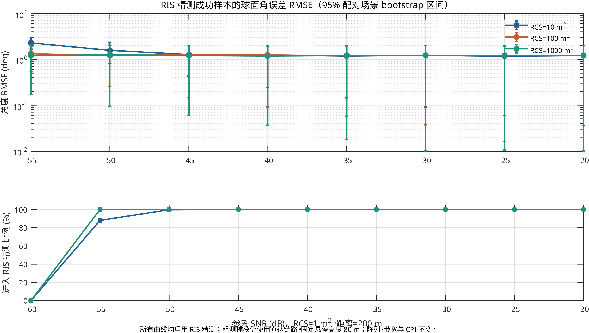

# UAV RIS SNR-angle sweep results

The full server run completed and passed its verification: 300 paired scenes,
RCS 10/100/1000 m^2, and reference SNR -60 to -20 dB in 5 dB steps, for
8,100 cases and 8,100 metric rows. Source hashes, SNR normalization, and all
per-case spherical-angle errors were verified.

Reference SNR is defined for a 1 m^2 target at 200 m. Noise was scaled while
transmit power and the full 28 GHz waveform stayed fixed (12,672 subcarriers,
16 Tx / 64 Rx elements, 256 symbols per CPI). RIS was enabled for fine
estimation. The existing coarse capture stage still uses the direct path, so
RIS fine-stage coverage is reported separately; at -60 dB no scene entered RIS
fine estimation for any RCS and angle RMSE is undefined there.

| RCS (m^2) | -60 dB coverage | -55 dB coverage / strict failure | -50 dB coverage / strict failure | -45 dB coverage / strict failure | -20 dB angle RMSE |
|---:|---:|---:|---:|---:|---:|
| 10 | 0% | 88% / 71% | 99.7% / 26.7% | 100% / 4.3% | 1.212 deg |
| 100 | 0% | 100% / 11% | 100% / 1% | 100% / 1% | 1.215 deg |
| 1000 | 0% | 100% / 1% | 100% / 1% | 100% / 1% | 1.215 deg |

At -20 dB, the per-scene median angular RMSE is 0.0128, 0.0034, and 0.0011 deg
for RCS 10, 100, and 1000, respectively. Each RCS still has two scenes above
5 deg, with maxima near 16.8-16.9 deg. Those rare angular outliers dominate the
ordinary RMSE and create the wide 95% paired-scene bootstrap intervals
(approximately 0.01-1.98 deg). The wide intervals are a real tail-risk signal,
not plotting error. The next research step should diagnose these angular
outliers and improve coarse capture robustness; increasing SNR alone leaves a
roughly 1% strict-failure floor in this model.

This is not a RIS-versus-NoRIS gain comparison: it measures an RIS-enabled
fine-estimation chain after direct-path coarse capture.

Evidence: [curve summary](snr_summary.csv), [all 8,100 cases](case_metrics.csv),
[verification](verification.json), and [manifest](manifest.json).
