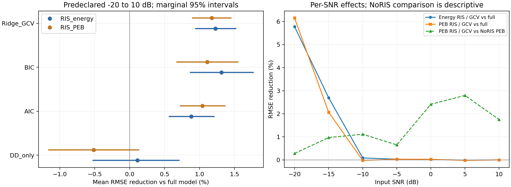

# 弱路径可靠性验证结果（2026-11-16）

3900/3900 组已完成，服务器状态为 COMPLETE，最终审计通过。
结论：自适应处理弱路径能改善原估计器，但主区间收益约 1%，相对强无 RIS
基线也只有很小的优势。目前适合作为估计器的改进模块，不能单独支持新的
高水平论文主创新。

## 验证范围与可信度

沿用用户指定的 Stage-3 模型与原始 300 个配对 Monte Carlo 场景，每个场景
13 个 SNR（-50:5:10 dB），共 3900 组。每组包含两种固定 RIS 设计及两个
无 RIS 对照，最终逐方法表为 62400 行。本轮没有加入 FAS。
保持原来的 16 发射/64 接收阵元、256 个 2-bit RIS 单元、12672 个子载波、
256+256 符号粗精 CPI、功率与 10 dB 通信 SINR 约束；完整假设见 README。
候选方法使用相同观测与初始化；算法计算量并不相等，筛选器需要拟合多个候选。

服务器逐样本复核了输入哈希、随机种子、参数、估计与选择器、错误和失败标志、
功率、SINR、RIS 量化及代价单调性。误差重算差异为 0，旧估计器回放差异为 0。
本地独立从 CSV 重算 208 个“方法×SNR”RMSE，并核对样本唯一性、两个目标
误差、失败、可行性、粗捕获和八项预设比较；与服务器 RMSE 最大差异为
`2.27e-13 m`。失败样本全部保留，没有以删掉失败点改善曲线。

## 预先设定的主结果

主指标：-20、-15、-10、-5、0、5、10 dB 七点，各自相对同一 RIS 设计下
Full_normalized 的 RMSE 降幅，再等权平均。括号为 4000 次配对场景 bootstrap
的边际 95% 区间；未进行多重比较校正。

| RIS 设计 | 方法 | 平均 RMSE 降幅 | 边际 95% 区间 |
|---|---|---:|---:|
| 能量设计 | 只拟合直达路径 | 0.11% | -0.52%～0.71% |
| 能量设计 | AIC | 0.88% | 0.57%～1.21% |
| 能量设计 | BIC | 1.31% | 0.87%～1.77% |
| 能量设计 | Ridge/GCV | 1.23% | 0.94%～1.52% |
| PEB 设计 | 只拟合直达路径 | -0.51% | -1.16%～0.13% |
| PEB 设计 | AIC | 1.04% | 0.73%～1.36% |
| PEB 设计 | BIC | 1.11% | 0.68%～1.55% |
| PEB 设计 | Ridge/GCV | 1.17% | 0.90%～1.45% |

自适应筛选/收缩比一律保留四路径更稳健，但收益很小。固定删除所有反射路径
不稳定，主区间的区间包含 0；不能得出“弱路径应该全部删掉”的结论。
归一化前后全路径结果基本一致，本次结果不支持把现象归因于列尺度的数值问题。

## 低信噪比的改善，不能直接当作 RIS 的收益

下表统一使用 PEB 设计。-30 dB 是完整 13 点结果中的探索性观察，不替代上述
预设主区间。单位为米，误差定义为两目标位置误差的总体 RMSE。

| SNR | RIS 全路径估计 | RIS + Ridge/GCV | 无 RIS + PEB |
|---:|---:|---:|---:|
| -30 dB | 4.0123 | 2.7599 | 2.7210 |
| -25 dB | 1.7703 | 1.5340 | 1.5227 |
| -20 dB | 0.9162 | 0.8599 | 0.8623 |
| 0 dB | 0.08384 | 0.08382 | 0.08589 |
| 10 dB | 0.02552 | 0.02552 | 0.02597 |

- -30 dB 时，Ridge/GCV 相对原全路径估计约改善 31%，失败数从 100/300
  降到 26/300；但无 RIS 对照误差更小，失败为 23/300。
- 在主区间，PEB RIS + Ridge/GCV 相对强无 RIS PEB 对照的平均 RMSE
  降幅约 1.42%。这是描述性附加比较，没有预设的配对置信区间，不能据此
  宣称显著或普遍优势。
- -50 和 -45 dB 时，粗捕获均为 0/300，各方法返回相同的粗估计；-40 dB
  为 63/300，-35 dB 为 290/300。此实验保留原捕获门限，因此不支持“RIS
  改善初始捕获或遮挡重捕获”的结论。

结果符合以下解释：在弱路径难以可靠估计时，强行增加待估参数会拖累精定位；
筛选/收缩能减轻这种负担。PEB 设计的 BIC 在 -30 dB 的 300 个样本全部选择
只拟合 DD，在 10 dB 全部选择 DD+RD+DR，均未选择 RR。路径是否值得使用
会随信噪比变化。但现成的 BIC/Ridge 已能做到这一点，尚未体现新方法的必要性。

逐噪声实现用真值挑最优候选，主区间也只有约 7% 的平均改善。这只是候选库的
乐观诊断，既不是可实现方法，也不是理论上界，不能用它否定其他算法的可能性。

## 对论文主线的判断

这轮支持“弱路径利用存在估计代价，应该按可靠性处理”，但不支持“这样处理
就能让当前 RIS 场景获得明显优势”。直接把 AIC/BIC/正则化换个名字，或只强调
-30 dB 的降幅，不能构成充分创新。

现有代码可以保留为后续工作的估计器与对照。若继续推进，应先验证 RIS 是否
在某些几何或直达路径受限条件下提供强无 RIS 系统缺少的信息，并检查实际 RMSE
能否兑现，而不是继续仅调弱路径选择器。这是待验证方向，本轮没有验证遮挡模型、
新的联合 RIS 配置或新的传播模型，也没有证明它们一定有效。

## 汇总故障恢复及复现

样本于北京时间 2026-11-15 约 20:54 全部算完。原汇总器在结构体初始化后赋值
时报错，该错误在服务器 R2022b 的独立小例子中复现。修复为按完整字段预分配。
本地对实际汇总代码段进行了两行比较、负收益、分位点及 JSON 往返的冒烟检查。

修复前 GitHub 备份为 `codex/pre-path-summary-fix-20261116`，SHA
`e1e95efa3750c30ff6e1a0019f98567ce8688f27`，修改前已核对远端。
原仿真源版本仍为 `05ceb490774157ee1df8ce7c4a11fa36e0a3a096`；汇总修复版本
为 `88a8a3790887d706258af6d38d589907aaa16865`，已推送并独立核对远端 SHA。
服务器核对了原 manifest 的所有源文件，修复版本中唯一改变的已列入 manifest
的源文件是 `aggregate_path_reliability.m`，估计与模型代码未变。原文件和失败日志
保留，3900 个样本没有重算。

第一次恢复命令在 MATLAB 启动器的换行转义处失败，尚未执行汇总函数；保留该
失败日志，改用 `%c` 输出换行后重新启动。服务器于北京时间 2026-11-16
12:10:37 完成全部审计并写入 COMPLETE。

原始 manifest ID：
`effa89b542b1e9a6b6ec2d9a53e11f58ca89e097e51a94af405d3111acbed5b3`。
数据及小型汇总导出位于项目的
`server-results/matlab-fas/path-reliability/05ceb490774157ee1df8ce7c4a11fa36e0a3a096/`。
运行 `python tools/analyze-path-reliability.py <该目录>` 可独立复算并生成
`analysis.json`、`per_snr_summary.csv` 和 `effect_sizes.png`。
使用现有含 NumPy/Matplotlib 的 Python 环境，不需要安装新依赖。

GitHub 选择备份修复代码、分析脚本、本文、小型 manifest/审计/汇总/恢复证据、
208 行逐 SNR 汇总及两张图。62400 行逐样本 CSV 的本地副本、原始运行/故障日志、
服务器原始 MAT、既有未跟踪输出、凭据、运行环境和缓存不纳入本轮备份，均保留原位。

