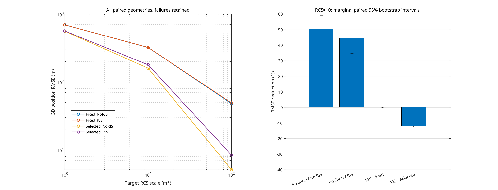

# UAV 悬停部署基础实验：2026-11-16 正式结果

**完整仿真和核验已完成。悬停位置选择改善了当前基线，但当前 RIS 设计/估计流程没有呈现额外定位收益；中低 RCS 条件下，整体定位可靠性仍不足。** 这支持继续研究基站位置这一自由度，尚不能证明 UAV+RIS 联合优化方案已有效。

正式结果来自服务器 MATLAB R2022b：300 个独立随机几何 × 3 个目标 RCS 尺度 = 900 个配对条件，每个条件包含四种方案，共 3600 行指标。RCS 尺度乘以两个目标的相对 RCS `[1, 0.8]`；三个尺度使用相同的几何与配对随机种子。全部失败样本保留。运行中未按结果调整参数。

28 GHz、12672 子载波、16 发射/64 接收阵元、256 个 2-bit RIS 单元、每阶段 256 个 OFDM 符号、1 W 总平均发射功率及固定热噪声均沿用预先记录的正式配置。本地缩小规模的冒烟测试仅用于检查程序分支，以下性能数字全部来自服务器全量运行。

下表为全部 300 个几何、两个目标合并计算的三维位置 RMSE，单位 m。它不是逐场景 RMSE 的算术平均。

| RCS 尺度（m²） | 固定位置，无 RIS | 固定位置，有 RIS | 选择位置，无 RIS | 选择位置，有 RIS |
|---|---:|---:|---:|---:|
| 1 | 693.85 | 693.85 | 559.41 | 564.06 |
| 10 | 322.48 | 322.48 | 159.90 | 179.31 |
| 100 | 48.24 | 49.23 | 5.14 | 8.42 |

预先指定的主对照为 **RCS=10、无 RIS 时的选位与固定位置比较**：RMSE 降低 **50.41%**，4000 次配对几何 bootstrap 的边际 95% 区间为 **[41.33%, 58.96%]**。独立 Python 重采样给出 [41.62%, 58.88%]，随机数实现不同，结论一致。不过，159.90 m 的绝对误差和下表中的高失败率表明，该条件下仍然不能可靠定位。两组共同通过粗捕获门限且精估计可行的几何仅 1 个，无法据此断言主对照的改善来自捕获后的精度提高。

粗捕获门限通过率和失败率必须同时看。门限通过只表示两个谱峰满足原估计器的判据，**不保证两个目标被正确识别或定位**。失败定义为：未通过粗捕获门限、精估计设计不可行，或任一目标三维误差超过 5 m。

| RCS 尺度 | 指标 | 固定，无 RIS | 固定，有 RIS | 选位，无 RIS | 选位，有 RIS |
|---|---|---:|---:|---:|---:|
| 1 | 粗捕获门限通过率 | 0% | 0% | 0% | 0% |
| 1 | 失败率 | 100% | 100% | 100% | 100% |
| 10 | 粗捕获门限通过率 | 0.67% | 0.67% | 36.33% | 34.67% |
| 10 | 失败率 | 100% | 100% | 90.33% | 97.33% |
| 100 | 粗捕获门限通过率 | 97% | 97% | 100% | 100% |
| 100 | 失败率 | 46.67% | 89.67% | 17.67% | 45.33% |

RCS=1 时四种方案都未进入精估计；其中约 19% 的选位 RMSE 降幅只是失败输出误差的变化，不能当成成功定位的证据。RCS=100 时，无 RIS 选位方案的全部样本 RMSE 从 48.24 m 降到 5.14 m，降幅 89.35%，边际 95% 区间 [79.61%, 94.60%]；场景误差的中位数从 3.79 m 降到 2.13 m。即便在这个较强回波条件下，无 RIS 选位方案仍有 53/300 个失败样本。

RIS 的增量需要单独比较，不能把选位收益归给 RIS。下表的“RMSE 降幅”为 `100 × (1 − 有RIS RMSE / 无RIS RMSE)`，负数表示变差。

| 对照 | RCS 尺度 | RMSE 降幅 | 边际 95% 区间 |
|---|---:|---:|---:|
| 固定位置，加入 RIS | 10 | −0.002% | [−0.0068%, 0%] |
| 各自选位，加入 RIS | 10 | −12.14% | [−32.56%, 4.19%] |
| 固定位置，加入 RIS | 100 | −2.04% | [−11.14%, 0.49%] |
| 各自选位，加入 RIS | 100 | −63.89% | [−177.01%, −23.70%] |

这些区间未作多重比较校正，只有前述主对照是预先指定的主检验。RCS=10 的选位后 RIS 对照区间跨零，不能断言总体 RMSE 退化具有统计确定性；RCS=100 下，当前带 RIS 的完整流程则明显更差，失败样本由 53/300 增至 136/300。

两个选位方案各自搜索同样的 9 个候选位置，因而 RIS 对照还包含选点变化。事后描述性检查发现，201/300 个几何中两方案选到相同悬停点；在这些几何的 RCS=100 条件下，RMSE 仍从 5.01 m 变为 7.44 m，说明退化不能全部归因于选点不同。该子集不是新增的确认性检验。

目前可作出的研究判断是：**先保留 UAV 悬停选位作为基线，优先查清 RIS 的作用条件与估计稳定性。** 四路径模型在真值处的合成/拟合一致性已通过冒烟检查，但这不保证弱 RIS 路径下的参数估计稳定；相移规则、代理选位目标、路径幅度自由度及估计器数值条件都仍需单独消融。当前结果还不能判定其中哪一项导致退化。

下一轮更有价值的问题是：直达链路遮挡、目标运动或先验不确定时，UAV 运动与 RIS 能否提高观测可辨识性和重捕获能力。在研究这个问题前，需要先建立 RIS 开启时也能粗捕获的流程，并设置相同资源预算的对照。当前直达 LoS、静止目标、悬停期间不移动的实验不能回答这个问题。

本轮采用理想无损被动 RIS、自由空间 LoS、已知通信 CSI、10 m 标准差的目标位置先验，以及 ZF 通信加零空间感知波束的启发式设计；沿用中心频率阵列响应和理想频域 OFDM 近似。未验证连续轨迹、飞行时间/能耗、机体姿态、CPI 内平台运动、动态跟踪、遮挡、杂波、残余自干扰及真实硬件。全部假设和采样预算见 [README](README.md)。当前流程先关闭 RIS 做 DD 粗捕获，因此尤其不能据此宣称 RIS 辅助首次捕获或遮挡重捕获有效，也不能据此否定 RIS 在其他场景的价值。

结果与源码可追溯：

- 冻结的仿真源码提交：`ad35a777ca7f697f2ea369db834f60f9f9f24277`。
- 正式 manifest：`2c4e15b4c6e77f03589d42c0ad23b92af4ce8b4fbbb41b49f23103a3f80efd87`。
- 服务器全部 8 个进程完成 900 个断点；服务器审计重新计算误差、核验源文件哈希、功率、SINR、量化相移和选点规则。最大归一化发射功率为 1.0000000000000004（浮点舍入），已进入精估计的设计最低通信 SINR 为 10.00000434 dB。
- 本地 Python 标准库独立复核了 3600 行的唯一性、随机种子、原始目标误差、失败定义、各组指标及 18 个运行源文件的 Git 内容哈希，RMSE 最大重算差异为 `5.68e-14 m`。
- 小体积证据位于仓库根目录的 [结果目录](../../../server-results/uav-foundation/ad35a777ca7f697f2ea369db834f60f9f9f24277/)：逐场景 CSV、汇总 JSON、PNG、manifest、部署哈希、完成状态、服务端审计和独立审计 JSON。复核命令为 `python tools/audit-uav-foundation.py server-results/uav-foundation/ad35a777ca7f697f2ea369db834f60f9f9f24277`，在仓库根目录运行。
- 每个样本的完整参数、真值、先验、种子、估计和设计保留在服务器 `/home/jzm123/AAA_ZTEproject/RIS_UAV_foundation/releases/ad35a777ca7f697f2ea369db834f60f9f9f24277/code/uav/results_full/samples/`，运行日志和逐进程进度也留在同一实验目录。完整波形未保存，未将大型 MAT 断点复制到本地或纳入 Git。
- 本轮结果整理前的 GitHub 备份分支 `codex/pre-uav-results-20261116` 已核对远端提交为上述源码版本；更早的修改前备份为 `codex/pre-uav-foundation-20261116`。备份仅包含已选择的源码、脚本、文档和小体积结果证据；凭据、本地环境、缓存及原有未跟踪的大型输出不在备份范围内，均保持原位。

