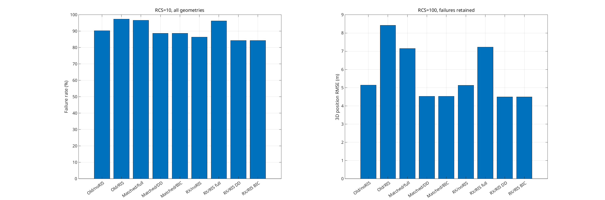

# UAV–RIS 通感基础：正式诊断结果（2026-11-16）

本轮已完成服务器全量仿真：300 个几何样本 × RCS=1/10/100 m²，共 900 个工况、15 种方法、13,500 行指标。8 个工作进程全部 COMPLETE，最后一个进程于北京时间 2026-11-16 18:53:13 完成。失败样本全部保留，服务器汇总和独立复核均通过。

结论是：**简化弱反射路径的估计模型有效；接收波束合并能改善粗检测，但当前低 RCS 定位仍不可靠；本轮尚不能证明 RIS 带来了稳定的额外定位收益。** 当前基础是无人机选点后悬停，不包含连续飞行轨迹优化。

## 1. 实验与统计口径

正式源码冻结在 `51f541a92e38903ddb593f03d4eeb73f27ae970c`，manifest ID 为 `f71b3325f8e976bb531d9a356deb0b0be36b24600e09fde784ccf9e08d9f03fa`。后续独立审计与本文不改变这次仿真的源码、参数或估计结果。

沿用完整资源：28 GHz、12,672 子载波、16 Tx/64 Rx、256 个 2-bit RIS 单元、粗测与精测各 256 符号；空间抽样分别为 384×64 和 256×64。平均发射功率 1 W，用户 SINR 要求 10 dB，物理热噪声模型保持不变。方法和额外计算开销见 [实验设计](README.md)。未使用 FAS。

除原有 RIS 独立选点基线外，匹配比较统一使用原 Selected_NoRIS 的悬停位置。候选模型在同一物理四路径数据上拟合，DD 表示直接往返路径；DD 拟合不等于物理观测中删除 RIS。BIC 在 8 个包含 DD 的路径子集间选择，不使用真实位置选模型。

位置 RMSE 汇总所有样本的两个目标 XYZ 误差。严格失败定义为：未通过捕获门限、精测设计不可行、或任一目标位置误差大于 5 m，三者满足其一即失败。“通过捕获门限”不能直接解释为捕获了正确目标。

两个预先指定的主要对比按完整几何样本配对 bootstrap 4,000 次，种子 20261118，分别报告 **97.5% 区间**，对两个主要对比作 Bonferroni 校正。其他区间为次要比较的边际 95% 区间。这是此前已观察过的同一批 300 个几何样本的诊断重放，尚无独立留出验证。

## 2. 主要结果

| 方法 | RCS=10 RMSE / m | RCS=10 失败率 | RCS=100 RMSE / m | RCS=100 失败率 |
|---|---:|---:|---:|---:|
| 原 NoRIS，原选点 | 159.90 | 90.33% | 5.140 | 17.67% |
| 原 RIS，自身选点 | 179.31 | 97.33% | 8.423 | 45.33% |
| 匹配位置 RIS，完整四路径拟合 | 160.01 | 96.67% | 7.145 | 44.00% |
| 匹配位置 RIS，DD 拟合 | 159.94 | 88.67% | 4.528 | 19.00% |
| 匹配位置 RIS，BIC | 159.85 | 88.67% | 4.528 | 19.00% |
| 接收波束合并 NoRIS | 125.59 | 86.33% | 5.124 | 19.00% |
| 接收波束合并 RIS，完整拟合 | 125.34 | 96.33% | 7.229 | 43.67% |
| 接收波束合并 RIS，DD 拟合 | 125.19 | 84.33% | 4.496 | 17.67% |
| 接收波束合并 RIS，BIC | 125.05 | 84.33% | 4.496 | 17.67% |

RCS=1 时所有 15 种方法的严格失败率均为 100%。接收波束合并将 NoRIS RMSE 从 559.41 m 降至 215.56 m，绝对误差仍远超要求。

主要对比一：RCS=10 时，接收波束合并使 NoRIS 失败率从 90.33% 降至 86.33%，减少 **4.00 个百分点，97.5% 区间 [-0.33, 8.33] 个百分点**。区间包含零，不能宣称已确认可靠性改善。RMSE 的次要改善为 21.46%，95% 区间 [9.33%, 32.94%]，但 125.59 m 仍不可接受。

主要对比二：RCS=100 时，匹配位置 RIS 的 BIC 将完整拟合 RMSE 从 **7.145 m 降至 4.528 m，减少 36.63%，97.5% 区间 [18.47%, 57.64%]**。原采集与接收波束合并两组各 300 个样本，BIC 均选择 DD-only，支持减少弱路径拟合。

RIS 的净收益仍需单独判断：RCS=100 时，接收波束合并后的 NoRIS→RIS-BIC 为 5.124→4.496 m，改善点估计 12.26%，但次要 95% 区间 **[-1.13%, 39.03%]** 包含零；失败率减少 1.33 个百分点的区间也包含零。因此，BIC 优于原四路径估计器，不能直接当作 RIS 物理增益的证据。



## 3. 原因诊断

### 3.1 RIS 路径本身弱，投影还会损失反射能量

RCS=100、原采集方式、匹配 RIS 位置下，600 个目标的单独路径能量诊断中位数如下。单位 dB，信号能量按实际观测累积后除以热噪声方差；不是每根天线的输入 SNR，未计路径间交叉项。

| 指标 | DD | RD | DR | RR |
|---|---:|---:|---:|---:|
| 投影前累积路径能量 / 噪声 | 25.78 | -29.11 | -23.66 | -82.87 |
| 投影后累积路径能量 / 噪声 | 25.77 | -47.19 | -42.91 | -101.62 |
| 投影能量保留比 | -0.011 | -19.05 | -19.13 | -20.54 |

保留比逐目标计算后取中位数，所以不等于表中两行中位数相减。反射路径在投影前已经很弱，基于粗估初始化的投影又只保留约 1% 的单反射路径能量，同时几乎完整保留 DD。仅改投影无法保证获得足够的 RIS 信息。以上使用真值的路径分解仅用于离线诊断。

### 3.2 弱路径拟合与非线性优化不足共同造成问题

完整模型包含 DD-only 作为可行子模型，但 RCS=100 时，完整归一化拟合的最终残差平方和仍高于已经找到的 DD-only 解：原采集 47/300，接收波束合并 48/300；RCS=10 时分别为 30/109 和 79/300 个具有候选拟合结果的样本。这直接说明部分完整拟合未达到一个已知可行解，不能将全部退化笼统归因于统计过拟合。

简单列归一化没有实质改善：与原完整拟合的组 RMSE 差异小于 2×10⁻⁸ m。RCS=100 时完整归一化字典条件数中位数约 4.10，也不支持“普遍严重线性病态”这个解释。

固定原 NoRIS 发射波束 W 后打开 RIS，RCS=100 时 NoRIS、RIS 完整拟合、RIS-DD 的 RMSE 分别为 5.13950、7.06521、5.13941 m，支持拟合极弱附加路径会损害估计的判断。**这组固定 W 方法仅 27/300 样本满足通信 SINR，因此只能诊断，不能作为可部署性能。**

去掉精测噪声、保留原来带噪声的粗估初始化和捕获门限后，RCS=100 时 RIS 完整拟合仍为 5.066 m、失败率 14.00%；RIS-DD 为 3.362 m、0.33%，与无 RIS 无噪声诊断接近。精测噪声之外仍存在初始化、模型与局部优化问题；无噪声结果不是可实现性能，也不是理论界。

原 RIS 自身选点→匹配位置完整拟合的 RMSE 为 8.423→7.145 m，点估计改善 15.17%。位置差异只能解释一部分退化。

### 3.3 接收合并改善检测，粗测角与局部初始化仍是瓶颈

先验指向的单位范数接收波束，使实际粗测输入 SNR 增益中位数达到 15.21 dB；RCS=10 的捕获门限通过率由 36.33% 升至 100%。但对应粗估距离、极角、方位角 RMSE 分别仍为 **0.572 m、11.75°、48.26°**。109/300 个样本不存在将两个真实目标同时放入原精测局部搜索盒的目标对应，28/300 个样本的粗估极角触及 ≥89.99° 边界；RCS=100 时两项均只有 1/300。

这解释了“检测门限全部通过，定位仍大量失败”的现象。真值在局部盒外不必然意味着位置误差超过 5 m，但显示局部精测难以纠正粗测角错误。

接收合并额外假设能相干访问已有 64 路校准接收通道的全带宽数据，以数字处理替代原中心单通道的完整距离–多普勒采集；没有增加天线、射频链、带宽、观测时间或发射导频，但增加了前端数据访问和数字计算要求。该假设需在硬件实现前验证。

### 3.4 异常值与先验基线不能忽略

单独返回已有的带噪位置先验，位置 RMSE 为 14.059 m；任一目标误差超过 5 m 的比例为 98.33%，所以先验同样不满足精度要求。不过，它的平均误差远低于低 RCS 下的测量流水线，说明后者含有严重离群值。

事后诊断规则“捕获标志为 false 时返回已给先验”可将原 NoRIS 的 RCS=1 RMSE 从 559.41 m 降至 14.06 m，RCS=10 从 159.90 m 降至 43.33 m。接收合并在 RCS=10 全部通过门限，因此该规则无法改善其 125.59 m 误差。这是事后分析，未更改正式输出、捕获标志或严格失败定义，不代表已经解决质量判决问题。

另用最小 XYZ 误差匹配目标进行了敏感性检查：低 RCS 的 RMSE 有变化，严格失败率保持不变；RCS=100 没有任何样本更换匹配，主要结论不变。

## 4. 下一步建议与适用范围

建议先完成能避免错误估计覆盖先验的质量判决，以及结合先验的稳健粗测角/多起点初始化，再复测低 RCS 的绝对误差、离群值和失败率。应预先规定规则并使用新的独立几何与随机种子，避免继续在这 300 个样本上反复调参后作为泛化证据。

随后在有物理依据的遮挡或弱直达场景检验 RIS 能否提供原本缺失的信息，同时审查反射链路预算与投影覆盖。当前全 LoS 几何中极弱的 RIS 链路不足以支持将性能改善归因于 RIS。无人机轨迹、飞行能耗和跟踪可以在稳定的单次感知基础上再引入。**这些是建议，尚未实施或完成测试。**

当前仍采用静止地面目标、理想 LoS/悬停和校准阵列等基础假设；尚无连续轨迹、移动目标跟踪、飞行能量约束或硬件验证。方法 7–11 的固定 W/无噪声实验仅为诊断。不能将本轮结果表述为已完成无人机轨迹联合优化或已验证低 RCS 可靠感知。

## 5. 复核、文件与备份

- [逐工况指标 CSV](../../../../server-results/uav-diagnosis/51f541a92e38903ddb593f03d4eeb73f27ae970c/case_metrics.csv)、[汇总与全部对比](../../../../server-results/uav-diagnosis/51f541a92e38903ddb593f03d4eeb73f27ae970c/summary.json)、[完成状态](../../../../server-results/uav-diagnosis/51f541a92e38903ddb593f03d4eeb73f27ae970c/completion_status.json)。
- [服务器验证](../../../../server-results/uav-diagnosis/51f541a92e38903ddb593f03d4eeb73f27ae970c/verification.json)：900/900，13,500 行；旧 NoRIS 重放误差 0；合成相对误差最大 3.48×10⁻¹⁶；可行设计最低 SINR 10.000004 dB，功率误差仅浮点舍入。
- [独立 Python 复核](../../../../server-results/uav-diagnosis/51f541a92e38903ddb593f03d4eeb73f27ae970c/independent_audit.json)：检查唯一工况、种子、45 组统计、42 项对比、母实验基线及 25 个源码 Git blob 哈希；RMSE 重算最大差 8.53×10⁻¹⁴ m。独立 bootstrap 使用不同语言随机数实现，主要两区间分别为 [-0.33, 8.67] 个百分点及 [19.43%, 57.32%]，与正式区间结论一致。
- [优化与先验诊断](../../../../server-results/uav-diagnosis/51f541a92e38903ddb593f03d4eeb73f27ae970c/optimizer_audit.json) 为正式运行后的独立审计；工具 SHA256 为 `d85c044be91233bb25f8c4765965fe7757eb5951a7ae0625b5a73249c9ef00a5`。全量原始 MAT 断点、参数、逐样本种子和日志保留于服务器：`/home/jzm123/AAA_ZTEproject/RIS_UAV_foundation/releases/51f541a92e38903ddb593f03d4eeb73f27ae970c/code/uav/diagnosis/results_full`。

复核命令（项目根目录）：

```powershell
python tools/audit-uav-diagnosis.py server-results/uav-diagnosis/51f541a92e38903ddb593f03d4eeb73f27ae970c
./tools/uav-foundation-server.ps1 status -Experiment diagnosis -Release 51f541a92e38903ddb593f03d4eeb73f27ae970c
```

整理本报告前，已将当前代码推送到 GitHub 分支 `codex/pre-uav-diagnosis-results-20261116`，并独立核对远端为 `e9f5918ac5884baaf61f591baef577988e892132`。阶段归档范围为相关源码、必要脚本、项目文档和选定的 CSV/JSON/PNG 证据；不上传凭据、本地环境、缓存、未经选择的历史产物或大型 MAT 集合。已有其他文件保持原状，大型原始数据留在服务器；代码与精选证据的 GitHub 归档不等于全量原始数据异地备份。
