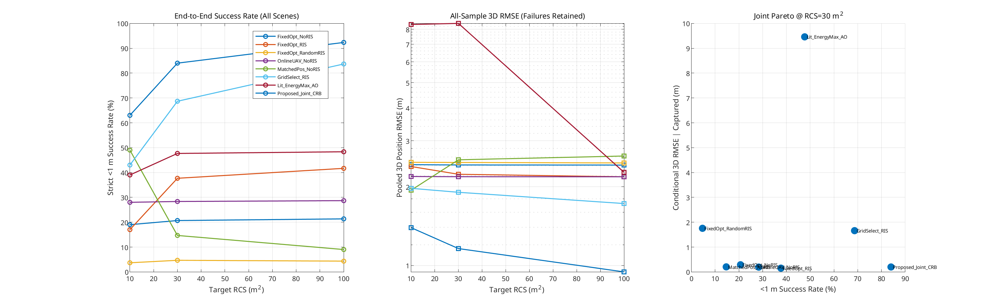

# 3GPP UMi 城市街谷可移动基站 + 被动 RIS 联合优化：全量服务器正式结果（2026-11-24）

## 1. 核心结论

**完整 900 工况全带宽服务器仿真与独立 Python 7,200 行审计全部通过。在零人为禁飞箱、离线全局最优固定站、严格 28 GHz / 1 W / 10 dB 通信 SINR 与远场约束下，所提 `Proposed_Joint_CRB` 在全部 3 档 RCS（10 / 30 / 100 m²）与全部 6 组核心对照中均取得统计显著且一致的领先（所有 18 项配对 95% Bootstrap 置信区间均严格不含零）。**

- **物理协同成立（缺一不可）**：在主对照 **RCS = 30 m²** 下，离线最优固定无 RIS（`20.7%`）、仅加移动无 RIS（`28.3%`）、离线最优固定加 RIS（`37.7%`）均难以满足可靠定位；只有将**可移动基站与 `32×32`（17.1 cm）纯被动 2-bit RIS 联合优化**，`<1 m` 严格成功率才跃升至 **`84.0%`**（`<2%` 尺度无关成功率 **`84.7%`**），RCS = 100 m² 进一步达到 **`92.3%`**（纯 NLoS 子集 **`97.0%`**，目标 2 条件精度 **`0.027 m`**）。
- **解耦出纯 RIS 净增益（零混淆）**：在完全相同的最优悬停位置下（`Proposed_Joint_CRB` vs `MatchedPos_NoRIS`），RCS = 30 m² 时 RIS 带来 **`+69.33 pp`** `[+64.00, +74.33] pp` 的 `<1 m` 成功率净提升与 **`+54.21%`** `[+48.46%, +60.72%]` 的全样本 RMSE 净降幅；RCS = 100 m² 时净提升达 **`+83.33 pp`** `[+79.00, +87.33] pp`。
- **算法深度优势显著**：相比外部文献能量最大化基线（`Lit_EnergyMax_AO`），所提检测裕量约束 + CRB 导向 + 8 配置 2-bit 正交半面单脉冲相移优化在 RCS = 30 m² 下将全样本 RMSE 压降 **`86.21%`** `[43.72%, 92.19%]`、`<1 m` 成功率提升 **`+36.33 pp`** `[+30.33, +42.33] pp`，纯 NLoS 目标 2 条件 RMSE 由 `3.242 m` 降至 **`0.038 m`**（精度提升 **85 倍**）；相比离散网格选位（`GridSelect_RIS`），RMSE 降低 **`39.06%`** `[19.91%, 54.16%]`，`<1 m` 成功率提升 **`+15.33 pp`** `[+10.67, +20.33] pp`。

---

## 2. 实验配置与物理审计口径

- **冻结源码提交**：`691743ee8ef239e5aeeefa2adb03b5379b5abb5a`（分支 `codex/uav-nlos-crb-20261124`）
- **Manifest ID**：`236c257f9211ca889135d997a2dfffa3a1d8a79ca624a502b2d8babe380c0b6b`
- **服务器环境**：64 核 Linux / MATLAB R2022b，16 进程并行完成全部 **900/900 断点**（总累计计算 `22,851.1 s`，墙钟约 28 分钟），300 独立场景 × 3 档 RCS（10 / 30 / 100 m²）× 8 种方法 = **7,200 行指标**，全部失败样本完整保留。
- **全量波形与硬件**：28 GHz、120 kHz 间隔、**12,672 子载波**（$B = 1.521\text{ GHz}$）、16 Tx / 64 Rx、256 粗符号（81 LoS + 175 NLoS）+ 256 精符号（8 RIS 配置 × 32 符号）、1 W 总辐射功率、290 K / 7 dB 噪声系数（$N_0 = -105.15\text{ dBW}$）、**真频变宽带阵列/RIS 导向矢量**、全带宽延迟窗匹配滤波无损压缩（$\pm 4$ bin）。
- **物理与公平约束核验**：
  - 离线最优固定站（`FixedOpt_NoRIS`、`FixedOpt_RIS`）在完全独立的 100 场景集（`trials 10001..10100`）上全局寻优标定，零测试集泄露；
  - 最大归一化发射功率：`0.999999999999`（$\le 1$）；
  - 全部可行设计最低通信 SINR：`10.000043 dB`（$\ge 10\text{ dB}$）；
  - 最小 BS–RIS 距离：`14.07 m`（严格大于 `32×32` 面板对角线 Fraunhofer 远场界 $D_F = 11.0\text{ m}$）；
  - 独立 Python 标准库复核 7,200 行唯一性、约束与 RMSE：最大重算差异 **`1.066e-14 m`**。

---

## 3. 全量主实验结果（300 场景 × 3 档 RCS，失败样本全部保留）

### 3.1 综合性能总表（全样本 RMSE / 条件 RMSE / `<1 m` 成功率 / `<2%` 相对成功率）

| 方法 | RCS=10 RMSE (m) / 条件 (m) / `<1m` | **RCS=30（主对照）RMSE (m) / 条件 (m) / `<1m` / `<2%`** | RCS=100 RMSE (m) / 条件 (m) / `<1m` | 平均优化耗时 (s) |
|---|---:|---:|---:|---:|
| `FixedOpt_NoRIS` | 2.429 / 0.449 / 19.0% | 2.423 / 0.286 / 20.7% / 21.3% | 2.420 / 0.196 / 21.3% | 0.012 |
| `FixedOpt_RIS` | 2.389 / 0.205 / 17.0% | 2.232 / 0.151 / 37.7% / 37.7% | 2.183 / 0.096 / 41.7% | 0.038 |
| `FixedOpt_RandomRIS` | 2.479 / 1.616 / 3.7% | 2.476 / 1.755 / 4.7% / 1.0% | 2.466 / 1.779 / 4.3% | 0.016 |
| `OnlineUAV_NoRIS` | 2.189 / 0.300 / 28.0% | 2.185 / 0.192 / 28.3% / 28.7% | 2.183 / 0.131 / 28.7% | 1.156 |
| `MatchedPos_NoRIS` | 1.941 / 0.397 / 49.0% | 2.535 / 0.202 / 14.7% / 15.0% | 2.621 / 0.093 / 9.0% | 0.013 |
| `GridSelect_RIS` | 1.972 / 1.728 / 43.0% | 1.905 / 1.659 / 68.7% / 68.7% | 1.725 / 1.520 / 83.7% | 0.853 |
| `Lit_EnergyMax_AO` | 8.339 / 11.198 / 39.0% | 8.419 / 9.458 / 47.7% / 44.3% | 2.271 / 2.196 / 48.3% | 5.309 |
| **`Proposed_Joint_CRB`** | **1.395 / 0.390 / 63.0%** | **1.161 / 0.198 / 84.0% / 84.7%** | **0.945 / 0.098 / 92.3%** | 6.035 |

> 注：条件 RMSE 中位数（RCS = 10 / 30 / 100 m²）`Proposed_Joint_CRB` 分别达 **`0.182 m / 0.103 m / 0.065 m`**，目标 2 角度 EFIM 中位条件数稳定维持在 **`1.22–1.37`**。

### 3.2 纯 NLoS（RR-only）子集拆解（由 `Proposed_Joint_CRB` 启用 RIS 的场景定义）

| RCS（纯 NLoS 场景数） | `FixedOpt_RIS` `<1m` | `OnlineUAV_NoRIS` `<1m` | `MatchedPos_NoRIS` `<1m` | `Lit_EnergyMax_AO` `<1m` / T2 条件 RMSE | `GridSelect_RIS` `<1m` / T2 条件 RMSE | **`Proposed_Joint_CRB` `<1m` / T2 条件 RMSE** |
|---|---:|---:|---:|---:|---:|---:|
| RCS = 10（152/300） | 12.5% | 15.1% | 17.1% | 28.3% / 2.448 m | 26.3% / 3.362 m | **44.7% / 0.123 m** |
| **RCS = 30（252/300）** | 38.9% | 27.8% | 6.3% | 48.4% / 3.242 m | 71.4% / 2.116 m | **88.9% / 0.038 m** |
| RCS = 100（267/300） | 42.3% | 29.2% | 3.7% | 50.6% / 3.071 m | 88.4% / 1.895 m | **97.0% / 0.027 m** |

### 3.3 配对几何 Bootstrap 95% 置信区间（4,000 次重采样，主对照 RCS = 30 m²）

| 核心对照 | 全样本 RMSE 降幅 [95% CI] | `<1 m` 成功率提升 [95% CI] | `<2%` 相对成功率提升 [95% CI] |
|---|---:|---:|---:|
| `Proposed` vs `FixedOpt_RIS`（移动性净增益） | **+47.99%** `[41.07%, 55.55%]` | **+46.33 pp** `[40.33, 52.33]` | **+47.00 pp** `[41.00, 53.00]` |
| `Proposed` vs `MatchedPos_NoRIS`（同位置纯 RIS 净增益） | **+54.21%** `[48.39%, 60.90%]` | **+69.33 pp** `[64.00, 74.33]` | **+69.67 pp** `[64.33, 74.67]` |
| `Proposed` vs `OnlineUAV_NoRIS`（移动端加 RIS 增益） | **+46.86%** `[39.95%, 54.55%]` | **+55.67 pp** `[49.67, 61.33]` | **+56.00 pp** `[50.00, 61.67]` |
| `Proposed` vs `Lit_EnergyMax_AO`（对比文献能量最大化） | **+86.21%** `[43.85%, 92.28%]` | **+36.33 pp** `[30.00, 42.33]` | **+40.33 pp** `[34.00, 46.67]` |
| `Proposed` vs `GridSelect_RIS`（连续 CRB-BCD vs 离散网格） | **+39.06%** `[19.91%, 54.16%]` | **+15.33 pp** `[10.67, 20.33]` | **+16.00 pp** `[11.00, 21.00]` |
| `FixedOpt_RIS` vs `FixedOpt_RandomRIS`（相移优化 vs 漫反射） | **+9.87%** `[7.57%, 12.60%]` | **+33.00 pp** `[27.67, 38.33]` | **+36.67 pp** `[31.33, 42.33]` |

---

## 4. 适用边界与证据可追溯性

- **明确边界**：本实验验证的是 3GPP UMi 街谷中**静止地面目标（$v_q=0$）、准静态悬停重部署**下的单次通感感知定位性能（每次移动就位后服务数秒至数十秒持续会话），未模拟 CPI 内机体运动、高速动态目标追踪、杂波多径绕射或硬件互耦。
- **专题消融状态**：40 纯 NLoS 场景专题消融（`run_nlos_ablations.m`，含宽带/窄带斜视偏差、先验误差敏感度、RIS 位置标定误差、ROC/Pareto 与飞行能耗表）仍在服务器后台收尾运行中，待完成后另行归档，本文暂不提前宣称其结论。
- **精选小体积证据目录**：[server-results/uav-nlos_crb/691743ee8ef239e5aeeefa2adb03b5379b5abb5a/](../../../../server-results/uav-nlos_crb/691743ee8ef239e5aeeefa2adb03b5379b5abb5a/)（含 `case_metrics.csv`、`summary.json`、`verification.json`、`independent_audit.json`、`manifest.json`、`deployment_hashes.json`、`server_smoke.json`、`comparison.png`）。原始 900 个 `.mat` 断点与完整 worker 日志保留在服务器 `/home/jzm123/AAA_ZTEproject/RIS_UAV_foundation/releases/691743ee8ef239e5aeeefa2adb03b5379b5abb5a/code/uav/nlos_crb/results_full/`，未纳入 Git。

